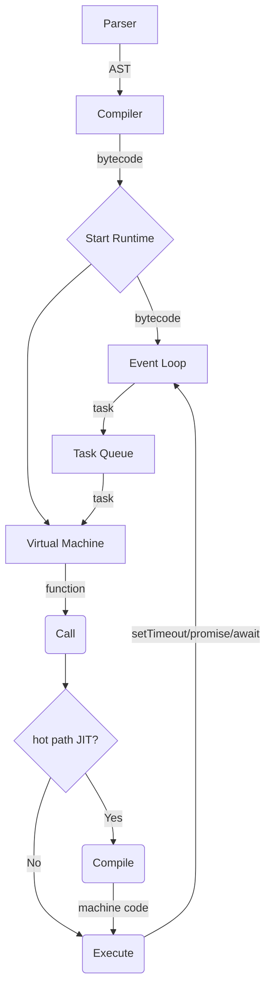

## GO_JS: A javaScript runtime and a JIT-compiler
A javascript runtime built from scratch using GO

**Features**

- Event loop (setTimeout, async/await, micro/macro task queues)
- [mark-and-sweep](https://en.wikipedia.org/wiki/Tracing_garbage_collection) Garbage collection
- Bytecode VM (A custom stack based virtual machine)
- [JIT](https://en.wikipedia.org/wiki/Just-in-time_compilation) compilation
- Closures / Classes 
- Core language support: Prototypal inheritance, for..of, for..in, while, for, try/catch, Promises, let/const, object destructuring, generators
- String, Date, Array, Object, Map, Promise and Set prototypes 

## Flow of execution / Design

1. [Parse](runtime/parser/parser.go) javascript file into an [AST](https://en.wikipedia.org/wiki/Abstract_syntax_tree), (uses a port of [acorn](https://github.com/acornjs/acorn) to golang.)
2. [Pre-pass](runtime/compiler/prepass.go) the syntax tree to define all variables to symboltables and figure out if anything is captured by a closure etc.
3. [Compile](runtime/compiler/compiler.go) the syntax tree into a custom [bytecode](https://en.wikipedia.org/wiki/Bytecode)
4. Start 2 goroutines, one for the [virtual machine](runtime/vm/vm.go) and one for the [event loop](runtime/eventloop/eventloop.go)
    - The vm listens to our eventloop
5. Dispatch our generated function (the bytecode) to the event loop
6. VM picks up our function and begins executing
   - during execution, if a function gets called more than the threshold for "hot path", and the [JIT compiler](runtime/jit/compiler.go) has translation steps for the bytecode used in the function, the VM requests a JIT compiled version of the function and executes it
   - all possible encounters with setTimeouts/await instructions are dispatched to our eventloop accordingly
   - when out of work VM will first drain the microtask queue, after that it will consumethe task queue
7. If our VM is not executing and eventloop doesn't have any work, we have finished our program



## Implementation Scope & A real world example

The runtime is not a _full_ ECMAScript implementation, for example `var` is completely omitted, it can handle an [Advent Of Code](test/aoc/solution.js) puzzle which encompasses a lot of useful language features, also scripts in the [test-scripts](test/test-scripts/) folder give a good representation of the language features implemented.

See the [ECMAScript implementation roadmap](ECMASCRIPT_ROADMAP.md) for prioritized features, implementation dependencies, and JavaScript regression tests.

## How to run
Requires go version `1.22.5`
1. `git clone` the repo
2. `cd /runtime`
3. `go run main.go <your_javascript_file.js>` use `--debug` flag to see all the fun stuff

Test suite can be run with docker by running `./test.sh` in the root of the repo.

## Web demo and MCP agent bridge

The web demo exposes one MCP endpoint per browser tab:

```text
https://<host>/session/<session-id>/mcp
```

Open the demo, copy the MCP endpoint shown above the editor, and give it to a
Streamable HTTP MCP client. The URL is a capability: anyone with it can run code
in the connected tab, so treat it as a secret.

The backend creates a fresh session when it serves the demo page and embeds
that session's bootstrap data in the HTML. The browser opens
`/ws/<session-id>` and attaches to the existing server-side session. A full page
reload gets a new session and a new MCP URL; WebSocket reconnects reuse the
session from the current page.

The MCP activity indicator is separate from the browser connection. It shows
`Agent active` after valid MCP traffic and `Last active` after 60 seconds without
traffic, so manual runs work without an MCP client connected.

The browser keeps one WebSocket connection to `/ws/<session-id>`. Both manual
submissions and MCP tool calls use that same connection:

1. An MCP client calls the `execute` tool.
2. The backend pushes the code to the browser over WebSocket.
3. The browser replaces the editor contents and submits the run.
4. The backend queues the job for the Firecracker worker pool.
5. The result is pushed back to the browser over WebSocket and returned to the
   waiting MCP tool call.

The session survives brief WebSocket disconnects and expires 30 minutes after the
browser tab disconnects. Session and in-flight job state are kept in memory;
restarting the backend invalidates active sessions.

For frontend development, the SvelteKit dev server asks the backend to create a
session and injects the same bootstrap data into the served HTML. It also proxies
`/ws` and `/session` to port `8000`, so the same browser-origin URLs work in
development and production.

## Test runner 
The test runner is neatly packaged in to a docker container.

**[`test.sh`](/test.sh)**

1. Discover all top-level `.js` files in [test-scripts](test/test-scripts/) and the configured [negative tests](test/negative-scripts/).
2. Run each case against NodeJS and GO_JS with the same Script or Module source goal.
3. Compare stdout and verify expected error classes/phases. Timeouts, crashes, and mismatches fail the suite.

```sh
./test.sh
```

The expanded ECMAScript tests run through this same Docker suite. [`test/cases.json`](test/cases.json) configures source-goal overrides, expected-error cases, and the per-process timeout. Imported fixtures are loaded by their entrypoints. The suite reports every case and exits nonzero if any regression, puzzle, or benchmark execution fails.

After the test run few benchmark scripts are also ran against nodeJS to compare the performance (essentially comparing against V8). Below is one example run summarized (The test suite was ran on my local machine)

| Benchmark | NodeJs | GO_JS |
| --- | --- | --- |
| 'naive-recursive-fib.js' | 545ms | 590ms |
| 'try-catch-shenanigans.js' | 1037ms | 509ms |
| 'string-operations.js' | 14ms | 49ms |
| 'array-iteration.js' | 34ms | 108ms |
| 'object-access.js' | 55ms | 481ms |
