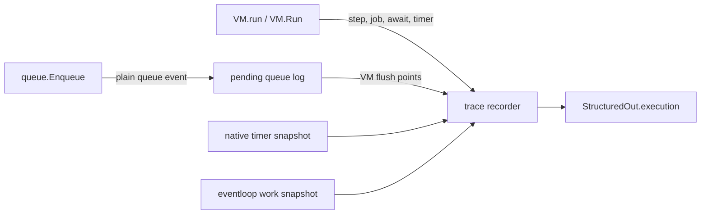

# Execution Animation Plan

**Status:** message format v2 and runtime execution capture are implemented. Frontend
animation playback is still pending.
**Scope:** `runtime/` execution tracing plus the web demo plumbing needed to return and play the trace.
**Audience:** the implementation agent for the runtime, and the frontend agent that consumes the result.
**Related documents:** `runtime/jit/PLAN.md`, `README.md`, `web/backend/microvm/microvm.go`, `web/frontend/src/routes/+page.svelte`, `web/frontend/src/types.ts`.

Already landed for the unified message:

- every `value.ValueChunk` has a stable `ChunkID` (`c1`, `c2`, ...),
- `debug_chunks` is the only chunk-metadata field, with `id`, `name`, `kind`,
  `hidden`, `byte_code`, and `jit`,
- the structured response has `format_version: 2` and an `execution` placeholder with
  `status: "not_requested"` and `frames: []`,
- the frontend consumes `debug_chunks` directly and uses chunk ids for
  expansion/highlighting while displaying the same function names, panels, toggles,
  and JIT/bytecode views.

The animation work below still needs the playback UI; the runtime capture hooks are implemented.

The goal is to make the website able to animate a completed run: step through bytecode,
show the VM stack, show the event loop, and show the task and microtask queues. The
animation must make `await` and `setTimeout` understandable. JIT internals are out of
scope; a JIT call is a single "Executing JIT..." placeholder followed by its result.

---

## 0. Decisions in one page

1. **Frames are full snapshots, not deltas.** Each frame carries the event-loop
   state, both queues, and new output. Frames at an instruction boundary also carry
   the complete VM state (all frames and the stack); queue/timer transition frames may
   omit the VM snapshot when no instruction is active, and the frontend carries the
   last VM view forward. This lets the frontend seek/scrub without replaying the whole
   run. Output is the only delta field.
2. **Trace is opt-in.** Add `--trace-execution`. The normal interpreter and the test
   suite pay nothing when it is off. The web backend passes the flag.
3. **One versioned message.** The structured response has a top-level
   `format_version: 2`, a `debug_chunks` array with a stable `id` per bytecode chunk,
   and an `execution` object. Until the animation is implemented, `execution` is an
   explicit placeholder with `status: "not_requested"` and `frames: []`. Frames will
   reference the same `chunk.id` used by `debug_chunks`.
4. **Capture at instruction boundaries.** A normal frame is captured immediately
   before executing the bytecode instruction at `op_ptr`. The next frame shows the
   effects of that instruction. `op_ptr` is the raw byte offset used by the matching
   `debug_chunks[].byte_code[].op_ptr`, so frontend highlighting already works.
5. **Event-loop transitions are first-class frames.** Queue enqueue, timer scheduling,
   `await` suspension, job start/end, waiting, and JIT entry/exit produce synthetic
   frames. This is what makes `setTimeout` and `await` visible even when no bytecode
   runs between the transition and the next instruction.
6. **Queue events are recorded under the queue mutex into a small pending log**, then
   materialized into frames on the VM goroutine. This keeps frame order deterministic
   and avoids touching the JS heap from the event-loop goroutine.
7. **The VM stack is logical, not a Go stack.** `vm.frames` plus `vm.stack[0:stackTop]`
   is the source of truth. Sub-VMs created by `callValue` are labelled with their own
   `vm.id`/`parent_id` rather than pretending their stacks are merged with the caller.
8. **JIT is a placeholder.** On entering compiled code, emit a frame whose stack top is
   the synthetic value `Executing JIT...`. On exit, emit a frame with the real result
   already on the VM stack. No machine instruction tracing and no bridge-frame spam.
9. **Hard limits.** Default maximum is 10,000 frames, 64 stack values, 32 queue items
   per queue, 16 timers, and 160 display characters per value. Truncation is explicit
   in metadata and never silently produces a broken frame array.
10. **Errors are out of scope for v1.** The runtime currently exits through
    `diagnostic.Fatal` before structured output is printed. Successful runs are
    animated; a later change can add error frames by removing that `os.Exit`.

---

## 1. What the runtime does today

This section records the exact behaviour the trace must reflect. Line numbers are
approximate and may move.

### 1.1 VM dispatch loop

`runtime/vm/vm.go`, `func (vm *VM) run(...)` (~2970):

```go
for {
    code := c.Code[ip]
    ip++

    if heap.ShouldRunGCCycle() {
        vm.runGC()
    }

    if flags.Debug {
        fmt.Println(f.fn.String())
        printStack(vm.stack[:vm.stackTop])
        fmt.Println(chunk.OpNames[code])
    }

    switch code {
    ...
    }
}
```

Important points:

- `ip` is a **byte offset** into `c.Code`, not an instruction index. Operands advance
  it. Jump targets are byte offsets.
- `debug_chunks[].byte_code[].op_ptr` is the byte offset of the opcode start.
  The animation frame must use that same value. Capture `opIp := ip` before `ip++`.
- Every `value.ValueChunk` now has a stable `ChunkID` (`"c1"`, `"c2"`, ...), and
  `debug_chunks[].id` is that value. Animation frames will use it directly.
- `vm.stack` is one contiguous array shared by all call frames. `f.localStart` for the
  active frame is the base of its locals/operands.
- `vm.stackTop` is authoritative; values above it are stale and must not be captured.
- `vm.frames[0:vm.frameCount]` is the JS call stack. The top frame is
  `vm.frames[vm.frameCount-1]`.
- The same `vm.run` loop is used for:
  - normal interpreter execution,
  - async function resumption after `await`,
  - generator resumption through a sub-VM,
  - a one-instruction replay of a JIT bridge instruction,
  - promise executor callbacks and promise reaction callbacks through `callValue`
    sub-VMs.

### 1.2 Event loop, tasks, and microtasks

`runtime/queue/queue.go` keeps two `container/list` queues:

- `q.microTask` (`queue.MICRO_TASK`)
- `q.task` (`queue.TASK`)

`queue.Dequeue()` always checks the microtask list first, then the task list. Therefore
the VM drains **all** currently runnable microtasks before taking the next task. A
microtask enqueued by another microtask will also run before the next task.

`runtime/eventloop/eventloop.go`:

- `eventloop.Dispatch(job)` increments `eventloop.work`, sends the job to a goroutine.
- `Job.Work` eventually sends an `object.JobChannelMessage` to `jobCallbackChannel`.
- The callback goroutine calls `queue.Enqueue(message.Callback, priority, true)` and
  `message.Done()`. `Done` decrements `eventloop.work`.
- `queue.Enqueue` increments the global wait-group and signals `queue.QueueC`.
- `VM.Run` dequeues in a loop, runs the callback, and waits on `queue.QueueC` or a
  100 ms ticker when both queues are empty.

Consequences for the animation:

- `eventloop.work` is **not** the number of queued callbacks. It counts jobs that have
  not yet produced a queue callback (timers still waiting, an `await` job blocked on a
  promise, etc.). Use `queues.*` for ready callbacks and `work` for outstanding jobs.
- `setTimeout` callbacks are ordinary tasks.
- `await` resumptions and promise reactions are microtasks.
- `setTimeout(fn, 0)` does not run before the current synchronous job finishes. It only
  becomes a task after the timer job wakes and enqueues it.

### 1.3 `setTimeout` / timers

`runtime/vm/host.go`, `scheduleTimer` (~773):

```go
fn.Set(delay, callbackFn, thisCtx, args)
clone := fn.Clone()
key := heap.NewCallbackRoot()
clone.SetRootKey(key)
heap.StoreCallbackRoot(key, callback, thisCtx, args...)
id := native.RegisterTimer(clone)
eventloop.Dispatch(clone)
return id, nil
```

`native.SetTimeout.Work` (`runtime/native/constructor.go`) either enqueues immediately
for a non-interval zero-delay timer, or waits on a ticker and then sends the callback
to the event-loop callback channel. `setInterval` re-dispatches itself after `Done`.

`native/timer.go` keeps `timerRegistry map[int]*SetTimeout`. It currently never removes
one-shot timers after they fire, so a timer snapshot must track a fired/cancelled state
or the UI will show old timers as pending forever.

### 1.4 `await`

`runtime/vm/vm.go`, `case chunk.OP_AWAIT` (~8409):

1. Pop the awaited value.
2. If it is not a `*native.ObjPromise`, look for a callable `then` and adopt it, or make
   an already-resolved promise.
3. If the function is an async generator, suspend the generator and return to the
   caller.
4. If the function is `*native.ObjAsyncFunction`:
   - Save the stack, IP, scopes, and exception handlers in `ObjAsyncFunction.State`.
   - If the promise is already settled, put its value into the saved stack and enqueue
     the async function as a **microtask** directly.
   - If the promise is pending, call `curentAsyncFn.Await(promise)`, which dispatches
     the async function as an event-loop job. `ObjAsyncFunction.Work` blocks on the
     promise channel, then sends the async function back as a **microtask**.
   - Restore the caller stack and pop the async frame, so the caller continues while the
     async function is suspended.
5. The async function's saved `Ip` is the instruction **after** `OP_AWAIT`; that is the
   resume pointer.

The animation therefore needs an explicit `await_suspend` event frame containing the
async function name, the resume `op_ptr`, and the awaited promise. A later `enqueue`
frame with source `"await"` explains when the continuation became runnable.

### 1.5 JIT

- Hot function calls enter `vm.runJIT` from `vm.Call` (`runtime/vm/vm.go` ~2744).
- Hot loop backedges enter `vm.tryOSR` from jump handling (~4019).
- `runJIT` either finishes (`jitFinished`), deoptimizes (`jitDeoptimized`), or resumes
  after a throw (`jitResumed`).
- Bridges replay individual bytecode instructions through a synthetic chunk that ends
  in `OP_JIT_HALT`. Those synthetic instructions must not fill the animation with
  internal frames.
- Direct self-recursion inside compiled code is invisible to Go. We only see the outer
  JIT entry and final exit.

The animation contract is deliberately small:

- entry frame: synthetic stack top `Executing JIT...` plus `vm.jit.state = "running"`;
- exit frame: real result on the stack plus `vm.jit.state = "done"` (or `deopt`/`throw`);
- OSR uses the same frame kind with `mode: "osr"` and the loop-header bytecode IP.

### 1.6 Structured output and the web path

`runtime/main.go` packs the unified message:

```go
out := virtualMachine.StructuredOut{
    FormatVersion: virtualMachine.StructuredOutputFormatVersion,
    Output:        output.String(),
    DebugChunks:   info.Chunks,
    Ast:           ast,
    Execution:     virtualMachine.NewExecutionPlaceholder(),
}
// json.Marshal -> base64.StdEncoding.EncodeToString -> stdout
```

`runtime/vm/debug.go` defines `StructuredOut`, `DebugInfo`, and the chunk list.
`DebugInfo.AddCallable` walks every chunk reachable from constants and emits
bytecode/JIT disassembly keyed by the chunk's stable `ChunkID`. Setup and module-wrapper
chunks are marked `hidden`.

`execution` is currently a placeholder:

```json
{
  "schema_version": 1,
  "status": "not_requested",
  "frames": [],
  "truncated": false,
  "total_frames": 0,
  "dropped_frames": 0,
  "duration_ms": 0,
  "limits": {
    "max_frames": 10000,
    "max_stack": 64,
    "max_queue_items": 32,
    "max_timers": 16,
    "max_value_chars": 160
  }
}
```

The web backend runs:

```text
go_js --structured /workspace/script.js
```

and the frontend base64-decodes the result in `handleRunResult`. The trace will fit into
this existing envelope; no new transport is needed.

---

## 2. Goals and non-goals

### Goals

- Explain the event loop with ready-to-run task and microtask queues.
- Explain stack-based bytecode execution: current opcode, call frames, operands, locals.
- Explain `setTimeout`: timer scheduled, callback queued as a task, task runs after
  microtasks.
- Explain `await`: async function suspends, awaited promise, continuation queued as a
  microtask, continuation resumes with the settled value.
- Show JIT only as a placeholder that consumes the current function call and returns a
  value.
- Keep frames self-contained and bounded so a browser can scrub them.
- Keep output, AST, bytecode, and JIT disassembly available in the unified message.

### Non-goals for v1

- Animating JIT machine instructions, registers, bridges, deopts instruction by
  instruction, or GC.
- Streaming frames live over the WebSocket while the program is still running.
- Animating runtime errors. The current `diagnostic.Fatal` + `os.Exit(1)` path means the
  structured JSON is never printed on failure. The web already shows failure as text.
- Collecting heap object graphs. Stack values are short display snapshots.
- Making the trace a stable public API across unrelated runtime changes. Bump
  `schema_version` when fields change incompatibly.

---

## 3. Trace model

### 3.1 Frame kinds

| `kind` | Meaning | `vm` present? | `event` present? |
| --- | --- | --- | --- |
| `boot` | Program compiled, event loop about to start | no | no |
| `step` | Before executing one bytecode instruction | yes | no |
| `event` | Queue/timer/await/job/waiting transition | usually last known VM | yes |
| `jit` | JIT/OSR entry or exit placeholder | yes | yes (`jit_enter`/`jit_exit`) |
| `end` | Program finished successfully | no | yes (`done`) |

An `event` frame may have `vm: null`. The frontend must carry forward the last VM view
rather than blanking the stack whenever a queue event appears.

### 3.2 What a frame represents

Normal `step` frames are captured **before** the instruction executes:

```
frame N:   op_ptr = call, stack = [args, callee]
frame N+1: op_ptr = first opcode of callee, stack = [args, ...]
```

This is the clearest mental model for a "next instruction" animation: highlight the
instruction, animate the transition to the next frame, see the stack change. The
frontend can also diff frame N and N+1 to explain what the instruction did.

Synthetic event frames are inserted at the moment the transition happens. They do not
replace step frames.

### 3.3 Event ordering and determinism

The VM goroutine is the only consumer of queue events for frame generation. Queue
events are recorded into a small pending log while the queue mutex is held, then the VM
drains that log immediately before each frame it emits. This gives a stable order:

1. queue event happens (recorded under `q.mu`);
2. VM reaches the next capture point;
3. pending queue events become frames;
4. the VM frame for the capture point is appended.

Events that occur on the event-loop goroutine while the VM is running are therefore
placed after the last completed VM frame and before the next one. That is exactly how
they should read in the animation.

VM-sourced events (`timer_scheduled`, `await_suspend`) must flush pending queue events
before appending themselves. Otherwise an earlier queue event from the event-loop
goroutine could appear after a later VM event. Use `vm.flushTraceEvents()` at the start
of every VM record helper.

### 3.4 Identity

- `chunk_id` is the stable identity of a `*value.ValueChunk`. Chunks receive
  `"c1"`, `"c2"`, ... when they are created (`value.NewChunk`), and the same id is
  emitted in `debug_chunks[].id`. It disambiguates duplicate `fn` names and is
  what animation frames will reference.
- `fn` remains the human-readable function name (`PROGRAM_MAIN`, `MODULE ...`,
  `ANONYMOYS_FN`, etc.) and is used only for display. Duplicate names are legal now;
  two anonymous functions have two chunk ids.
- `vm.id` is the trace-local identity of a `VM` instance. The root VM is `1`; sub-VMs
  created by `callValue` get a new id and a `parent_id`. This is enough to render a
  "sub-VM" badge without pretending the stacks are merged.
- Object identities are `obj:<handle>` strings. They are only meaningful within a
  single run. Do not use them across runs or after GC for persistent state.

### 3.5 Output

Only output is delta-encoded. Each VM frame can contain:

```json
"output": { "delta": "hello\n", "length": 6 }
```

`length` is `strings.Builder.Len()` at capture time (bytes, not UTF-16 code units), so a
frontend that starts from an arbitrary frame cannot reconstruct the prefix without
summing earlier deltas. That is acceptable because the final `output` remains at the top
level of the structured response. During playback, maintain a running string by
appending `delta`.

Reading `strings.Builder.String()` on every frame is wasteful. Check `.Len()` first and
only materialize the string when it grew.

---

## 4. JSON schema

All field names are snake_case, matching the existing `debug_chunks`, `ast_id`, and
`op_ptr` fields. The schema below is the contract with the frontend.

### 4.1 Top level

The unified structured message:

```ts
export interface InterpretDetails {
  format_version: 2;
  output: string;
  debug_chunks: DisassembledChunk[];
  ast: AstNode;
  execution: ExecutionInfo;
}

export interface DisassembledChunk {
  id: string;                // "c1", "c2", ... stable for the run
  name: string;              // display name, may repeat (anonymous functions)
  kind?: "main" | "module" | "function" | "async_function"
       | "generator" | "async_generator" | "setup";
  hidden?: boolean;          // setup chunks and module wrappers
  byte_code: DisassembledOp[];
  jit: DisassembledJit[];
}

export interface DisassembledOp {
  ast_id: number;
  op: string;
  op_ptr: number;            // byte offset into the chunk
}

export interface DisassembledJit {
  inst: string;
  op_code_ptr: number;
  ast_id: number;
}

export interface ExecutionInfo {
  schema_version: 1;
  status: "not_requested" | "complete" | "truncated" | "error";
  frames: ExecutionFrame[];
  truncated: boolean;
  total_frames: number;
  dropped_frames: number;
  duration_ms: number;
  limits: ExecutionLimits;
}

export interface ExecutionLimits {
  max_frames: number;
  max_stack: number;
  max_queue_items: number;
  max_timers: number;
  max_value_chars: number;
}
```

`debug_chunks` is the single source of function identity. Animation frames carry a
`chunk_id` that must match one of these `id` values. `name` is display-only and may
repeat. `hidden` chunks are filtered by the frontend; the setup chunk and module-import
wrapper are hidden.

`execution` is always present in `format_version: 2`. Until the animation work lands,
it is an explicit placeholder with `status: "not_requested"` and `frames: []`.
`total_frames` counts every frame the recorder attempted to append. `dropped_frames`
counts frames not stored because a limit was hit. `len(frames)` is therefore
`total_frames - dropped_frames` (except that the final `end` frame is always reserved
one slot). If `truncated` is true, the UI must show a visible notice.

The decoded structured response therefore looks like:

```json
{
  "format_version": 2,
  "output": "A\nB\n",
  "debug_chunks": [
    {
      "id": "c2",
      "name": "PROGRAM_MAIN",
      "kind": "main",
      "byte_code": [ { "op": "0000 | OP_CONSTANT \\n0004 | 0 \\n", "ast_id": 1, "op_ptr": 0 } ],
      "jit": []
    }
  ],
  "ast": { "id": 1, "type": "Program", "start": 0, "end": 20, "ast_train": [] },
  "execution": {
    "schema_version": 1,
    "status": "not_requested",
    "frames": [],
    "truncated": false,
    "total_frames": 0,
    "dropped_frames": 0,
    "duration_ms": 0,
    "limits": { "max_frames": 10000, "max_stack": 64, "max_queue_items": 32, "max_timers": 16, "max_value_chars": 160 }
  }
}
```

Frontend lookup: find a chunk with
`debug_chunks.find((chunk) => chunk.id === chunkId)`, use `chunk.name` only for display,
and filter `chunk.hidden`. Highlight identity is `chunkId`, never the function name.
Duplicate anonymous functions intentionally produce multiple visible chunks.

### 4.2 Frame

```ts
export interface ExecutionFrame {
  seq: number;               // monotonically increasing; may have gaps if truncated
  kind: "boot" | "step" | "event" | "jit" | "end";
  at_ms: number;             // monotonic milliseconds since trace start
  note?: string;             // optional human-readable fallback narration
  event?: ExecutionEvent;    // present for event/jit/end frames
  vm?: VMState;              // absent on boot/end and on some event frames
  event_loop: EventLoopState;
  queues: QueueState;
  output?: OutputDelta;
}

export interface OutputDelta {
  delta: string;
  length: number;
}
```

`event_loop` and `queues` are always present so the frontend never needs to merge
partial state. For boot/end they are empty/`booting`/`done`.

### 4.3 VM state

```ts
export interface VMState {
  id: number;                // root VM = 1, sub-VMs get new ids
  parent_id?: number;        // set for callValue sub-VMs
  active_frame: number;      // index into frames; -1 if none
  op_ptr: number;            // byte offset, matches debug_chunks[].byte_code[].op_ptr
  op: string;                // mnemonic, e.g. "OP_AWAIT"
  ast_id: number;            // c.AstId[op_ptr], matches AST highlighting
  fn: string;                // top frame display name
  chunk_id: string;          // stable id from debug_chunks[].id
  frames: VMStackFrame[];
  frames_omitted?: number;   // bottom frames omitted by the call-depth cap
  stack: ValueView[];        // bottom -> top, may be capped to the top N
  stack_base: number;        // absolute slot index of stack[0]
  stack_top: number;         // displayed top: normally vm.stackTop; +1 for the
                             // synthetic "Executing JIT..." entry
  stack_omitted?: number;    // number of stack slots below stack_base not captured
  jit?: JITState;            // only on kind === "jit"
}

export interface VMStackFrame {
  index: number;             // 0 = outermost captured frame
  fn: string;
  chunk_id: string;
  op_ptr: number;            // top frame: current ip; paused frame: return ip
  op: string;                // mnemonic at op_ptr
  ast_id: number;
  local_start: number;       // vm.stack index of this frame's first local
}
```

`stack[0]` corresponds to absolute slot `stack_base`. The frontend renders slot
`stack_base + i`. If `stack_omitted > 0`, show a "… N slots hidden …" row before the
captured values. Frame boundaries still use the absolute `local_start`.

For paused (non-top) frames, `op_ptr` is `CallFrame.returnIp`, i.e. where execution
continues after the call returns. This is useful for "paused at caller" labels. The
frontend should not treat every frame's `op_ptr` as a currently executing instruction;
use `active_frame` for that.

### 4.4 Values

```ts
export interface ValueView {
  type: string;              // number, string, boolean, null, undefined,
                             // function, promise, array, object, error,
                             // bigint, map, set, regexp, class, iterator,
                             // method_handle, argument_start, empty, note, unknown
  display: string;           // short, lossy, already truncated; never parse this
  id?: string;               // "obj:17" for objects
  synthetic?: boolean;       // true for the "Executing JIT..." note
  promise?: PromiseView;
  function?: FunctionView;
}

export interface PromiseView {
  state: "pending" | "fulfilled" | "rejected";
  value?: ValueView;         // only for settled promises, depth 1
  reactions?: number;
  observers?: number;
}

export interface FunctionView {
  name: string;
  arity: number;
  async?: boolean;
}
```

`display` is intentionally lossy. It must never be used as an input to logic. The
frontend may show `promise.state`, `promise.value.display`, etc. for richer cards.

Value display rules:

- primitives: use the same text as the existing console formatting; handle `NaN`,
  `Infinity`, `-0`, `null`, and `undefined`.
- strings: quoted and escaped, truncated to `max_value_chars` with `…`.
- promises: `Promise <pending|fulfilled|rejected>` plus `promise` metadata.
- functions/async functions/generators: `<fn name>` plus metadata.
- arrays: `Array(n)`, not the full contents.
- errors: `Name(n): message` when available.
- objects: `[Object object]`, map/set/regexp/class use their `String()` form.
- invalid/stale handles: `{type:"unknown", display:"<invalid>"}`; never panic.
- JIT placeholder: `{type:"note", display:"Executing JIT...", synthetic:true}`.

Do not call recursive `native.TypeDecoratedString` for stack snapshots. It can walk
large arrays/objects and makes frame size unbounded. `native.String` has the same problem
for plain `ObjObject` values because it prints every member. Use `obj.String()` plus the
special cases above; for primitives, `native.String` is fine.

### 4.5 Queues

```ts
export interface QueueState {
  micro_tasks: QueueItem[];
  tasks: QueueItem[];
  micro_tasks_omitted?: number;
  tasks_omitted?: number;
}

export interface QueueItem {
  id: string;                // opaque, stable within a run, e.g. "q1"
  kind: "task" | "micro_task";
  label: string;             // "setTimeout(0ms) callback", "resume await in load"
  source?: string;           // "main", "setTimeout", "await", "promise",
                             // "queueMicrotask", "process.nextTick", "gc"
  fn?: string;               // function name when cheaply available
  native?: boolean;          // callback is a Go native callback
}
```

Array order is front (next to run) to back. `_omitted` counts truncated items at the
back. The frontend must not assume the arrays are complete when `_omitted > 0`.

### 4.6 Event loop and timers

```ts
export interface EventLoopState {
  phase:
    | "booting"    // trace started, main not dequeued yet
    | "executing"  // a current job exists
    | "queued"     // no current job, at least one ready callback
    | "waiting"    // no ready callback, timers/async jobs outstanding
    | "idle"       // no work at all, before the final end frame
    | "done";      // program finished
  next_queue?: "tasks" | "micro_tasks";
  current_job?: QueueItem;
  work: number;                // eventloop.work at snapshot time
  timers: TimerItem[];
  timers_omitted?: number;
}

export interface TimerItem {
  id: number;                  // native timer registry id
  delay_ms: number;
  label: string;               // "setTimeout(0ms) callback"
  repeats?: boolean;           // setInterval
  state: "pending" | "fired" | "cancelled";
}
```

`current_job` is the callback currently being run by `VM.Run` (including native
callbacks). `next_queue` is derived: microtasks win when both queues are non-empty.
`work` means outstanding event-loop jobs, not queued callbacks.

Phase computation:

```text
if done:                         done
else if not booted:              booting
else if current_job != nil:      executing
else if either queue non-empty:  queued
else if work > 0 or timer armed: waiting
else:                            idle
```

### 4.7 JIT

```ts
export interface JITState {
  mode: "call" | "osr";
  state: "running" | "done" | "deopt" | "throw";
  fn: string;                  // jitted function
  op_ptr: number;              // entry IP (0 for call, loop header for OSR)
  result?: ValueView;          // on done
  duration_ms?: number;        // entry -> exit
}
```

The entry frame has `kind:"jit"`, `event.type:"jit_enter"`, `vm.jit.state:"running"`,
and a synthetic note at the top of `vm.stack`. The exit frame has `kind:"jit"`,
`event.type:"jit_exit"`, the real result already on the stack, and `vm.jit.state` set
to `done`, `deopt`, or `throw`.

### 4.8 Events

```ts
export interface ExecutionEvent {
  type:
    | "enqueue"
    | "job_start"
    | "job_end"
    | "waiting"
    | "timer_scheduled"
    | "timer_cancelled"
    | "await_suspend"
    | "jit_enter"
    | "jit_exit"
    | "done"
    | "error";
  queue?: "tasks" | "micro_tasks";
  item?: QueueItem;            // enqueue/job_start/job_end
  fn?: string;                 // await_suspend/jit
  resume_op_ptr?: number;      // await_suspend
  promise?: ValueView;         // await_suspend
  timer?: TimerItem;           // timer_scheduled/timer_cancelled
  detail?: string;             // human-readable fallback
}
```

The `note` field on the frame may duplicate a short version of `detail`. Frontend
narration should prefer structured fields, then `note`, then a generic description.

### 4.9 Example frames

Abridged, valid shape for an `await` instruction:

```json
{
  "seq": 14,
  "kind": "step",
  "at_ms": 1.8,
  "vm": {
    "id": 1,
    "active_frame": 1,
    "op_ptr": 57,
    "op": "OP_AWAIT",
    "ast_id": 31,
    "fn": "load",
    "chunk_id": "c3",
    "frames": [
      { "index": 0, "fn": "PROGRAM_MAIN", "chunk_id": "c1", "op_ptr": 22, "op": "OP_CALL", "ast_id": 8, "local_start": 0 },
      { "index": 1, "fn": "load", "chunk_id": "c3", "op_ptr": 57, "op": "OP_AWAIT", "ast_id": 31, "local_start": 3 }
    ],
    "stack": [
      { "type": "promise", "display": "Promise <pending>", "id": "obj:12", "promise": { "state": "pending" } }
    ],
    "stack_base": 3,
    "stack_top": 4
  },
  "event_loop": {
    "phase": "executing",
    "current_job": { "id": "q1", "kind": "task", "label": "main script", "source": "main", "fn": "PROGRAM_MAIN" },
    "work": 0,
    "timers": []
  },
  "queues": {
    "micro_tasks": [],
    "tasks": []
  },
  "output": { "delta": "load:start\n", "length": 11 }
}
```

The following synthetic event frame explains the suspension:

```json
{
  "seq": 15,
  "kind": "event",
  "at_ms": 1.9,
  "note": "load is suspended at await; resume will be a microtask",
  "event": {
    "type": "await_suspend",
    "fn": "load",
    "resume_op_ptr": 58,
    "promise": { "type": "promise", "display": "Promise <pending>", "id": "obj:12", "promise": { "state": "pending" } },
    "detail": "await will resume when the promise settles"
  },
  "vm": { "...": "last completed VM snapshot if one is available" },
  "event_loop": {
    "phase": "executing",
    "current_job": { "id": "q1", "kind": "task", "label": "main script", "source": "main" },
    "work": 1,
    "timers": [
      { "id": 1, "delay_ms": 0, "label": "setTimeout(0ms) callback", "state": "fired" }
    ]
  },
  "queues": { "micro_tasks": [], "tasks": [ { "id": "q3", "kind": "task", "label": "setTimeout(0ms) callback", "source": "setTimeout" } ] }
}
```

JIT entry:

```json
{
  "seq": 120,
  "kind": "jit",
  "at_ms": 4.7,
  "note": "fib is running as JIT code",
  "event": { "type": "jit_enter", "fn": "fib" },
  "vm": {
    "id": 1,
    "active_frame": 0,
    "op_ptr": 0,
    "op": "OP_CONSTANT",
    "ast_id": 4,
    "fn": "fib",
    "chunk_id": "c7",
    "frames": [ { "index": 0, "fn": "fib", "chunk_id": "c7", "op_ptr": 0, "op": "OP_CONSTANT", "ast_id": 4, "local_start": 0 } ],
    "stack": [
      { "type": "number", "display": "30" },
      { "type": "note", "display": "Executing JIT...", "synthetic": true }
    ],
    "stack_base": 0,
    "stack_top": 2,
    "jit": { "mode": "call", "state": "running", "fn": "fib", "op_ptr": 0 }
  },
  "event_loop": { "phase": "executing", "current_job": { "id": "q1", "kind": "task", "label": "main script", "source": "main" }, "work": 0, "timers": [] },
  "queues": { "micro_tasks": [], "tasks": [] }
}
```

Exit:

```json
{
  "seq": 121,
  "kind": "jit",
  "at_ms": 4.8,
  "note": "JIT returned; the result is on the stack",
  "event": { "type": "jit_exit", "fn": "fib" },
  "vm": {
    "id": 1,
    "active_frame": 0,
    "op_ptr": 9,
    "op": "OP_POP",
    "ast_id": 4,
    "fn": "PROGRAM_MAIN",
    "chunk_id": "c1",
    "frames": [ { "index": 0, "fn": "PROGRAM_MAIN", "chunk_id": "c1", "op_ptr": 9, "op": "OP_POP", "ast_id": 4, "local_start": 0 } ],
    "stack": [ { "type": "number", "display": "55" } ],
    "stack_base": 0,
    "stack_top": 1,
    "jit": { "mode": "call", "state": "done", "fn": "fib", "op_ptr": 0, "result": { "type": "number", "display": "55" }, "duration_ms": 0.1 }
  },
  "event_loop": { "phase": "executing", "current_job": { "id": "q1", "kind": "task", "label": "main script", "source": "main" }, "work": 0, "timers": [] },
  "queues": { "micro_tasks": [], "tasks": [] }
}
```

---

## 5. Capture architecture

### 5.1 New package: `runtime/trace`

Create `runtime/trace` with **only schema and recorder logic**. It must not import
`vm`, `queue`, `eventloop`, `native`, or the JS heap. Internal packages depend on it,
not the other way around. This avoids import cycles and makes recorder tests trivial.

Suggested layout:

```text
runtime/trace/trace.go       // schema types + recorder
runtime/trace/trace_test.go  // pure recorder tests
runtime/vm/trace.go          // VM snapshots + hooks
```

Recorder responsibilities:

- enabled flag and limits,
- monotonic `seq`, start time, `at_ms`,
- append frames, enforce limits, reserve one slot for `end`,
- pending queue-event log (`RecordQueueEvent`),
- last VM snapshot pointer for queue-event frames,
- current `QueueItem` and boot/done phase,
- output delta accounting,
- final `ExecutionInfo` assembly.



Queue event flow:

```text
queue.Enqueue (holding q.mu)
    -> trace.RecordQueueEvent(qe)       // append to recorder pending log
    -> q.mu.Unlock()
VM flush point
    -> pending := trace.TakeQueueEvents()
    -> for each: build QueueState from qe.Snapshot, loop state from eventloop/native,
       VM from trace.LastVM(), then trace.AppendFrame(...)
```

`trace.RecordQueueEvent` only takes the recorder mutex. It never calls into `queue`,
`eventloop`, `native`, or the heap. Do not call `queue.Snapshot()` while holding the
recorder mutex, and do not call recorder methods while holding a lock that the recorder
might later need in reverse order. The queue event already carries the queue snapshot
computed under `q.mu`, so the VM never needs to re-lock the queue to render it.

A queue-event frame uses the queue snapshot captured at the enqueue moment, but its
`event_loop` section is built when the VM materializes the frame. That is deliberate:
the queue transition is historical, while `work`/timer state is best-effort current
state. Step and job frames use current snapshots for everything.

### 5.2 Queue changes

`runtime/queue/queue.go`:

- Add trace metadata to `object.Callback`:

  ```go
  type Callback struct {
      Fn          Callable
      ThisCtx     value.Value
      Stack       []value.Value
      Native      func()
      RootKey     uintptr
      MicroTask   bool

      TraceID     uint64 // assigned by queue.Enqueue
      TraceLabel  string // human label, set by the enqueue site
      TraceSource string // "main", "setTimeout", "await", "promise", ...
  }
  ```

- `queue.Enqueue` assigns `TraceID`, defaults an empty label to `"callback"`, pushes
  the callback, builds a `trace.Queues` snapshot under `q.mu`, records the enqueue event,
  unlocks, and sends `QueueC`. If `trace.Enabled()` is false, skip the snapshot/event work
  entirely; the normal enqueue path should stay almost as cheap as it is today.
- `TraceID` assignment can also be skipped when tracing is off, but it is cheap and
  useful for debugging. Either is fine as long as callbacks are still correct.
- The `TraceLabel`/`TraceSource` fields are cosmetic and must never affect execution.
- Add helper labels at every enqueue site (see §5.8).
- `Dequeue` should return the selected priority, or set `callback.MicroTask` from it, so
  the VM can set `current_job.kind` correctly:

  ```go
  func Dequeue() (object.Callback, TaskPriority, error)
  ```

  Update the three call sites in `VM.Run`.

- `Snapshot()` is optional if enqueue events carry their own snapshot. Step/job frames
  still need the current queues, so expose a function that builds `trace.Queues` from
  the current lists under `q.mu`. It must not call `Callback.Fn.String()` or touch the
  heap. Use `TraceLabel`, `TraceSource`, `TraceID`, and nil checks only.

Queue item conversion:

```text
id      = "q" + TraceID
kind    = "micro_task" or "task" from the list it is stored in
label   = TraceLabel or "callback"
source  = TraceSource
native  = Callback.Native != nil
fn      = optional, only if a cached TraceFunction was set at enqueue time
```

Do not call `Fn.ValueChunk()` from the queue snapshot path. It is unnecessary and could
race with user code. The VM can add the function name when it builds a job-start frame
because it already has the callback on the VM goroutine.

### 5.3 Event loop and timer snapshots

`runtime/eventloop/eventloop.go`:

```go
type Snapshot struct {
    Work   int64
    Closed bool
}

func SnapshotState() Snapshot {
    // work.Load(); lock el.mu only for closed
}
```

`runtime/native/timer.go` and `runtime/native/constructor.go`:

- Add trace label/source fields to `SetTimeout` (or reuse `Callback` fields on the
  stored callback) and a `Name()` method if needed.
- Add a `fired`/`done` state so one-shot timers stop looking pending after they fire.
- Add `TimerSnapshot() []TimerInfo` under `timerRegistryMutex`:

  ```go
  type TimerInfo struct {
      ID        int
      DelayMS   int
      Label     string
      Repeats   bool
      State     string // pending | fired | cancelled
  }
  ```

- `scheduleTimer` should set a label such as `"setTimeout(0ms) callback"` or
  `"setInterval(1000ms) callback"` on the clone before `RegisterTimer`, and record a
  `timer_scheduled` event before `eventloop.Dispatch`.
- `clearTimeout`/`clearInterval` may record `timer_cancelled` after cancellation.

If timer state is too invasive for v1, ship the timer list as best-effort and keep the
queue frames authoritative. Do not let timer bookkeeping change scheduling.

### 5.4 VM instrumentation points

Add a `runtime/vm/trace.go` with:

- `vm.beginTrace()`, `vm.finishTrace(output string) *trace.Execution`
- `vm.traceStep(f *CallFrame, c *value.ValueChunk, opIp int, code uint8)`
- `vm.traceJobStart(callback, priority)`
- `vm.traceJobEnd()`
- `vm.traceWaiting()`
- `vm.traceEvent(...)`, `vm.flushTraceEvents()`
- `vm.valueView(value.Value)`, `vm.vmState(...)`, `vm.loopState(...)`

Add `traceID int` and `traceParentID int` to `VM`, assigned in `NewVM`/`newSubVM`.

Instrumentation table:

| Location | Hook | Frame |
| --- | --- | --- |
| `main` after `NewVM`, before dispatch | `vm.beginTrace()` | `boot` |
| `VM.run` loop top, after reading `code` and before `ip++` effects | `vm.traceStep(...)` | `step` |
| `VM.Run` after `queue.Dequeue`, before running callback | flush + `vm.traceJobStart(...)` | `event` (`job_start`) |
| `VM.Run` after callback returns / native returns | `vm.traceJobEnd()` | `event` (`job_end`) |
| `VM.Run` after queues drained, before ticker wait | `vm.traceWaiting()` | `event` (`waiting`) |
| `scheduleTimer` | flush + `traceEvent(timer_scheduled)` | `event` |
| `OP_AWAIT` after promise is determined | flush + `traceEvent(await_suspend)` | `event` |
| `runJIT` entry after a valid entry exists | `vm.traceJITEnter(...)` | `jit` |
| `runJIT` status done/deopt/throw | `vm.traceJITExit(...)` | `jit` |
| `tryOSR` entry / done / deopt | same, `mode:"osr"` | `jit` |
| `main` after `wg.Wait` | `vm.finishTrace(output.String())` | `end` |

Do not instrument `flags.Debug` paths; the two modes are independent.

### 5.5 Step capture pseudo-code

```go
for {
    opIp := ip
    code := c.Code[opIp]
    ip++

    if tracing && !c.TraceHidden {
        vm.traceStep(&f, &c, opIp, code)
    }

    if heap.ShouldRunGCCycle() {
        vm.runGC()
    }

    switch code {
    ...
    }
}
```

`vm.traceStep`:

```go
func (vm *VM) traceStep(f *CallFrame, c *value.ValueChunk, opIp int, code uint8) {
    if !trace.Enabled() || c.TraceHidden {
        return
    }

    vm.flushTraceEvents()              // pending queue events get the previous VM state
    queues := queueSnapshot()          // lock queue, copy labels, unlock
    loop := vm.loopState(queues)       // eventloop.Snapshot + native.TimerSnapshot
    vmState := vm.snapshotVM(f, c, opIp, code)

    trace.SetLastVM(vmState)
    trace.AppendFrame(trace.Frame{
        Kind:      "step",
        VM:        vmState,
        EventLoop: loop,
        Queues:    queues,
    }, vm.outputSnapshot())
}
```

Build all heap-dependent values **before** taking the recorder lock. The recorder only
copies/append plain structs.

`c.TraceHidden` is a new `bool` on `value.ValueChunk`. Set it on:

- the internal setup chunk (`object.SETUP_FN_NAME`),
- the synthetic `JIT_BRIDGE` chunk created in `handleBridge` (the chunk is cloned and
  its `FnName` is changed to the real function, so a name check is not enough).

That suppresses bridge step spam and setup frames while still allowing a callee called
from a bridge to be traced normally.

### 5.6 Job start / end / waiting

`VM.Run` currently looks like:

```go
callback, errDequeue := queue.Dequeue()
for errDequeue == nil {
    if callback.Native != nil { ... }
    ...
    _, err := vm.run(f, c)
    ...
    callback, errDequeue = queue.Dequeue()
}
```

Change to:

```go
callback, priority, errDequeue := queue.Dequeue()
for errDequeue == nil {
    vm.flushTraceEvents()
    vm.traceJobStart(callback, priority) // sets trace current job, appends event

    if callback.Native != nil {
        callback.Native()
        if callback.RootKey != 0 { heap.ClearCallbackRoot(callback.RootKey) }
        vm.traceJobEnd()                 // clears current job, appends event
        callback, priority, errDequeue = queue.Dequeue()
        continue
    }

    ... existing stack/arg/async setup ...
    _, err := vm.run(f, c)
    ...
    vm.traceJobEnd()
    callback, priority, errDequeue = queue.Dequeue()
}
```

`traceJobStart` must flush pending queue events **before** setting `current_job`, so the
enqueue frame shows the item still queued and the job-start frame shows it running.
`traceJobEnd` flushes pending events, appends the `job_end` frame while `current_job` is
still set (so the UI can animate it out), then clears `current_job` and the last VM
snapshot. Later waiting/queue frames must not pretend a finished frame is still active.

When no queues are left, before the ticker:

```go
vm.flushTraceEvents()
vm.traceWaiting()
```

Skip the waiting frame if `eventloop.TryClose()` is already true (the end frame is
enough).

### 5.7 `await` capture

In `OP_AWAIT`, after the awaited promise is known and before the suspension branch:

```go
vm.flushTraceEvents()
vm.traceEvent(trace.Event{
    Type:         "await_suspend",
    Fn:           callableName(f.fn),
    ResumeOpPtr:  ip, // ip already points at the instruction after OP_AWAIT
    Promise:      vm.valueView(awaitee),
    Detail:       "await suspended; continuation will resume from the promise",
})
```

For an already-settled promise, the queue enqueue happens immediately after this event,
so the timeline is:

```text
step OP_AWAIT
await_suspend
enqueue micro_task "resume await in f"
step resumes at ip
```

For a pending promise, the event is followed by the async job being dispatched:

```text
step OP_AWAIT
await_suspend
job_end (caller continues)
waiting (work > 0)
...timer/promise resolution...
enqueue micro_task "resume await in f"
job_start micro_task
step resumes at ip
```

Set `TraceLabel` on the resumption callback in both places:

- the direct `queue.Enqueue(...)` in the already-settled branch;
- `ObjAsyncFunction.Work` in `runtime/native/asyncFunction.go`.

Use `"resume await in " + asyncFn.Name` and `TraceSource: "await"`.

### 5.8 Labels for queue items

Set `TraceLabel`/`TraceSource` at these sites:

| Site | Label | Source |
| --- | --- | --- |
| `native.Main.Work` | `"main script"` | `"main"` |
| `scheduleTimer` | `"setTimeout(<delay>ms) callback"` / `setInterval` | timer name |
| `VM.OP_AWAIT` direct enqueue | `"resume await in <fn>"` | `"await"` |
| `ObjAsyncFunction.Work` | `"resume await in <fn>"` | `"await"` |
| `queueMicrotask` | `"queueMicrotask"` | `"queueMicrotask"` |
| `process.nextTick` | `"process.nextTick"` | `"process.nextTick"` |
| `enqueueNativeCallback` promise observers | `"promise observer"` | `"promise"` |
| `settlePromise` / `attachPromiseReaction` | `"promise reaction"` or `"promise.finally"` | `"promise"` |
| `resolvePromise` thenable | `"promise thenable"` | `"promise"` |
| `FinalizationRegistry` cleanup | `"FinalizationRegistry cleanup"` | `"gc"` |

These are display strings only. The fallback when empty is `"callback"`.

### 5.9 Timer events

In `scheduleTimer`, after the clone is registered and before dispatch:

```go
vm.flushTraceEvents()
vm.traceEvent(trace.Event{
    Type:  "timer_scheduled",
    Timer: &trace.TimerItem{ID: id, DelayMS: delay, Label: label, Repeats: interval, State: "pending"},
    Detail: fmt.Sprintf("scheduled %s", label),
})
eventloop.Dispatch(clone)
```

Recording before `Dispatch` keeps the timer event ahead of the eventual queue enqueue
even for zero-delay timers. The next frame can show `work` updated.

### 5.10 JIT / OSR capture

`runJIT`:

```go
// Save the jitted identity before entering. On return, *c may have been
// overwritten with the caller's chunk, and *f with the caller's frame.
jitFn := f.fn
jitChunk := *c
entryIP := 0

// after cc.Entry(0) succeeds and before ctx.Enter
if trace.Enabled() {
    vm.traceJITEnter(jitFn, &jitChunk, entryIP, "call")
}
...
switch status {
case jit.StatusDone:
    result := act.Result
    ... push result, restore caller ...
    if trace.Enabled() {
        vm.traceJITExit(jitFn, &jitChunk, entryIP, "done", result, duration)
    }
case jit.StatusDeopt:
    ... copy activation to vm.stack, set currentIp ...
    if trace.Enabled() {
        vm.traceJITExit(jitFn, &jitChunk, entryIP, "deopt", value.UNDEFINED, duration)
    }
case jit.StatusThrow:
    ...
    vm.traceJITExit(jitFn, &jitChunk, entryIP, "throw", thrown, duration)
}
```

`tryOSR` mirrors this with `mode:"osr"` and `entryIP = target`. Save the jitted
function/chunk before entering for the same reason: `tryOSR` overwrites `*c` and `*f`
when compiled code finishes. If OSR declines before entering (`!cc.LoopOSRable`, no
entry, guard failure), emit nothing.

`traceJITEnter` builds the normal `VMState` from `vm.frames`/`vm.stack`, then appends the
synthetic note to a **copy** of the stack and sets `vm.jit`. It must not mutate
`vm.stack`. `traceJITExit` builds the state after the result was pushed and sets
`vm.jit.result`.

Do not emit frames from `handleBridge` per request. The synthetic bridge chunk is
hidden; a real callee invoked by the bridge is still traced normally.

### 5.11 Sub-VMs

`vm.newSubVM()` already copies shared counters. Add:

```go
sub.traceID = nextVMTraceID()
sub.traceParentID = vm.traceID
```

Sub-VM frames use the same global recorder and current event-loop job. The frontend can
show `vm.parent_id` as a badge. Do not merge sub-VM stacks into the caller's stack;
that would lie about the implementation and make frame boundaries meaningless.

Sub-VMs are included in v1 because promise executors and `.then` callbacks are user
code and are important for the `await`/promise showcase. If class-field initializers or
other internal sub-VMs become too noisy, add a `hidden`/`origin` flag to `VMState`
rather than silently dropping all sub-VMs.

### 5.12 Output capture

The trace recorder keeps `lastOutputLen`. Every frame appended from the VM goroutine
passes the current output builder length. If it grew, attach:

```json
"output": { "delta": "...new bytes...", "length": 123 }
```

Queue-event frames are appended by the VM flush path, so they can also carry the delta.
If a queue event is recorded on the event-loop goroutine, it only stores the pending
event; no output is read there. The next VM flush or the final `finishTrace` captures
the accumulated output.

### 5.13 Limits and truncation

Defaults (constants in `runtime/trace`, optionally flags for the first two):

| Limit | Default |
| --- | --- |
| `max_frames` | 10,000 |
| `max_stack` | 64 |
| `max_queue_items` | 32 per queue |
| `max_timers` | 16 |
| `max_value_chars` | 160 |
| call frames | 64 active frames |
| pending queue events | `max_frames * 2` |

When a limit is reached:

- keep updating the recorder's last VM/output state,
- increment `total_frames` and `dropped_frames`,
- stop appending normal frames,
- always reserve one slot for the final `end` frame.

The stack cap keeps the **top** values (the most recently pushed operands), because
those are what execution is about to consume. Set `stack_base`/`stack_omitted`
accordingly.

Queue and timer caps keep the **front** items (the ones that will run next) and set
`*_omitted` for the rest.

A frame must never be partially populated. Build it completely, then append.

---

## 6. Runtime change checklist

### 6.1 `runtime/flags/flags.go` and `runtime/main.go`

Add:

```go
TraceExecution = false
TraceMaxFrames = 10000
```

CLI:

```text
--trace-execution        Record frames for the execution animation
--trace-max-frames N     Maximum stored frames (default 10000)
```

Validation: `--trace-max-frames > 0`. If tracing is requested without `--structured`,
either ignore it or fail with a clear configuration error; do not silently write no
trace when the user asked for one.

Main wiring:

```go
queue.Init(&wg)
eventloop.Init(&wg)
vm := virtualMachine.NewVM(true, output)

if flags.TraceExecution && flags.StructuredOutput {
    vm.BeginTrace(trace.Limits{
        MaxFrames:      flags.TraceMaxFrames,
        MaxStack:       64,
        MaxQueueItems:  32,
        MaxTimers:      16,
        MaxValueChars:  160,
    })
}

go eventloop.Start()
go vm.Run(&wg)
eventloop.Dispatch(mainJob)
wg.Wait()

out := virtualMachine.StructuredOut{...}
if flags.TraceExecution && flags.StructuredOutput {
    out.Execution = vm.FinishTrace(output.String())
}
```

`BeginTrace` must run before `eventloop.Dispatch(mainJob)` so the main-task enqueue is
captured.

### 6.2 `runtime/object/object.go`

Add the trace metadata fields to `Callback` from §5.2. These fields are inert for all
existing behaviour.

### 6.3 `runtime/queue/queue.go`

- trace metadata on enqueue,
- `TraceID` assignment,
- enqueue event recording under `q.mu`,
- current-queue snapshot helper,
- `Dequeue` returns priority or sets `MicroTask`.

Update the three `queue.Dequeue` call sites in `VM.Run`.

### 6.4 `runtime/eventloop/eventloop.go`

- `SnapshotState() (Work, Closed)`.
- No tracing import needed.

### 6.5 `runtime/native/*`

- timer label/state/snapshot,
- async resume labels,
- promise callback labels,
- main-script label.

Prefer adding labels in the VM call sites where the full context is known. Keep the
native layer free of trace schema types where practical.

### 6.6 `runtime/vm/vm.go`, `jit_bridge.go`, `osr.go`

- `opIp` capture at loop top,
- `TraceHidden` on `value.ValueChunk` (set for setup and bridge chunks),
- step/job/wait/await/timer hooks,
- JIT/OSR hooks,
- `traceID`/`traceParentID` on `VM`.

### 6.7 `runtime/vm/debug.go`

Extend `StructuredOut`:

```go
type StructuredOut struct {
    FormatVersion int          `json:"format_version"`
    Output        string       `json:"output"`
    DebugChunks   []*ChunkInfo `json:"debug_chunks"`
    Ast           *parser.Node `json:"ast"`
    Execution     *ExecutionInfo `json:"execution"`
}
```

`debug_chunks` is the only chunk list from §4.1. `ExecutionInfo` is the placeholder now;
when the animation lands it grows real frames while keeping `schema_version`, `status`,
`frames`, and the limit metadata.

Do not key anything by `name`; use `chunk.id`. Function names are display-only and may
repeat.

### 6.8 Web backend

In `web/backend/microvm/microvm.go`, change the run command to:

```go
runCmd := fmt.Sprintf("%s --structured --trace-execution /workspace/script.js", RUNTIME_PATH)
```

No database, WebSocket, or MCP schema change is required. The result is still base64
JSON. Consider passing `--trace-max-frames=10000` explicitly so the runtime and web
demo stay in sync.

If the backend later wants to toggle animation per request, add the flag to the job
metadata rather than always tracing. For v1 always-on for web runs is acceptable
because only the website uses this path.

---

## 7. Worked timelines

### 7.1 `setTimeout` and promise ordering

```js
console.log("A");
setTimeout(() => console.log("T"), 0);
Promise.resolve().then(() => console.log("P"));
console.log("B");
```

Expected animation:

```text
boot
enqueue task   q1  main script
job_start     q1  main script
step          OP_CALL console.log("A")
step          ...                         output delta "A\n"
event         timer_scheduled             timers: [setTimeout(0ms)]
event         enqueue task q2             setTimeout callback
step          OP_CALL Promise.resolve
step          OP_CALL .then
event         enqueue micro_task q3       promise reaction
step          OP_CALL console.log("B")
step          ...                         output delta "B\n"
step          OP_RETURN
job_end       q1
job_start     q3  micro_task              microtasks drain before tasks
step          ...                         output delta "P\n"
job_end       q3
job_start     q2  task
step          ...                         output delta "T\n"
job_end       q2
end
```

The exact order of `timer_scheduled` vs `enqueue q2` depends on how fast the timer job
wakes, but the timer event is recorded before `Dispatch`, so it cannot appear after
`q2` in the trace.

### 7.2 `await`

```js
async function load() {
  console.log("load:start");
  await new Promise((resolve) => setTimeout(() => resolve(), 0));
  console.log("load:end");
}
console.log("main:start");
load();
console.log("main:end");
```

Expected story:

1. main runs to `load()`; the async function starts synchronously.
2. `load` logs `load:start`.
3. The promise executor calls `setTimeout`, producing a timer event and later a task.
4. `OP_AWAIT` sees a pending promise. `await_suspend` records `load`, the resume
   `op_ptr`, and the pending promise.
5. `load` returns its own promise to main; main logs `main:end` and finishes.
6. The timer task runs, calls `resolve`, and the async job becomes ready.
7. A microtask `"resume await in load"` is enqueued.
8. That microtask runs before any remaining task, resumes `load` at the saved IP with
   the resolved value on the stack, and logs `load:end`.

This is the primary showcase. The frontend should render the suspended await as a
distinct card until the matching `enqueue` event with `source:"await"` appears.

### 7.3 JIT

```js
function fib(n) { return n < 2 ? n : fib(n - 1) + fib(n - 2); }
console.log(fib(30));
```

With the JIT threshold reached, the trace contains a `jit` entry frame at the call site,
then a `jit` exit frame with the result at the top of the stack, then ordinary step
frames. Recursive machine-code calls inside `fib` are not visible. The frontend should
show `Executing JIT...` as a placeholder and skip detailed instruction animation.

---

## 8. Frontend contract

### 8.1 Parsing

`handleRunResult` already does `JSON.parse(atob(message.result))`. Add:

```ts
const interpretDetails = JSON.parse(atob(message.result)) as InterpretDetails;
```

Update `web/frontend/src/types.ts` with the interfaces from §4. `format_version`,
`debug_chunks`, and `execution` are part of `format_version: 2`. The current
placeholder has `execution.status: "not_requested"`, so the frontend must check the
status before trying to play frames. The page passes `interpretDetails.debug_chunks`
directly to `Code.svelte`, which filters chunks with `hidden: true`; setup and
module-wrapper chunks are not shown.

### 8.2 UI pieces

Recommended new component: `ExecutionAnimation.svelte`, plus small presentational
components if useful (`StackView`, `EventLoopView`, `QueueView`).

The animation panel needs:

- play/pause, step backward/forward, restart, and a scrub slider;
- speed control (frames per second, e.g. 2–60; default around 8–12);
- current frame counter (`n / total_frames`);
- narration line from `frame.note`, then `frame.event.detail`;
- stack panel grouped by `frame.vm.frames`, using `local_start` to split slots;
- event-loop panel with phase, current job, timers, `work`;
- two queue columns: microtasks on the left (or emphasized) and tasks on the right;
- live output panel fed by `frame.output.delta`;
- a truncation banner when `execution.truncated`.

### 8.3 Code highlighting

For `kind:"step"` and `kind:"jit"` frames with `vm`:

```ts
setHighlight({
  source: "op_code",
  astId: frame.vm.ast_id,
  opCodePtr: frame.vm.op_ptr,
  chunkId: frame.vm.chunk_id,
});
```

`frame.vm.op_ptr` is already in the units used by `Code.svelte` and
`debug_chunks[].byte_code`, and `frame.vm.chunk_id` is the exact chunk id, so no
name-based lookup is needed. For JIT exit frames, either keep the bytecode highlight at
the entry `op_ptr` or switch to the assembly view only on manual pause.

Do not auto-scroll the code/AST panels on every animation tick. Scroll on pause, on
manual step, or throttle to a few times per second. The existing highlight effect
scrolls on every change; the animation should either use a separate highlight path or a
`follow` toggle.

### 8.4 Stack rendering

- Use `frame.vm.frames` for the call-stack list. `active_frame` is the executing frame.
- A frame's slots are `stack[local_start - stack_base ... nextFrame.local_start - stack_base]`,
  clamped to the captured range. If `stack_base` is above a frame's `local_start`, show
  an "omitted" row instead of guessing values.
- Highlight the top value(s) that are about to be consumed.
- Render `type` as a badge and `display` as monospace text.
- For promises, show state and settled value if present.
- For the JIT synthetic value, render a distinct "JIT" card, not a normal stack slot.

### 8.5 Queue rendering

- Queue order is front-to-back. The first item is the next to run.
- Microtasks should be visually prioritized; when `current_job.kind === "micro_task"`,
  highlight the microtask queue. When it is `"task"`, highlight the task queue.
- When a frame's `event.type === "enqueue"`, animate the item into the named queue.
- When `job_start` fires, animate the item from its queue into `current_job`.
- When `job_end` fires, animate `current_job` out.
- Show `source` as a small tag (`setTimeout`, `await`, `promise`, `main`, ...).
- If `_omitted > 0`, show `+N more`.

### 8.6 Playback and seeking

- Use array index, not `seq`, for playback. `seq` can have gaps when truncated.
- Maintain a prefix-sum of `output.delta` lengths so seeking backward can reconstruct the
  output at any frame cheaply. Alternatively, store cumulative output at each frame in
  frontend memory.
- `at_ms` is informational. Do not sleep for real timer delays; playback speed is user
  controlled.
- Pause automatically on `await_suspend`, `timer_scheduled`, `jit_enter`, and the final
  `end` frame? Recommended: show a brief hold/annotation, not a hard pause, unless the
  user enabled "step through interesting events only".
- If `execution.status` is not `"complete"` (or `"truncated"` with frames), hide or
  disable the animation controls. The current placeholder is `"not_requested"`.

### 8.7 Handling incomplete traces

If `truncated` is true:

- show a banner: "Trace truncated after N frames; the final state is still shown."
- still allow playback to the end frame;
- do not claim the animation shows the whole run;
- keep the final output panel authoritative.

---

## 9. Testing plan

### 9.1 Recorder unit tests (`runtime/trace`)

- append/truncation: exactly `max_frames` stored, end frame always present,
  `total_frames`/`dropped_frames` correct.
- seq monotonic and gaps only from dropped frames.
- queue event ordering: enqueue A, enqueue B, flush -> A then B.
- output delta: multiple appends sum to the full output; no duplicate delta.
- JSON field names and `schema_version`.
- limits on stack/queue/timer arrays and omitted counts.
- no panic when a pending queue event has an empty snapshot or a nil VM.

### 9.2 VM integration tests

Add tests that run a small script through the real parser/compiler/VM with tracing on.
If a full harness is awkward, add a small test binary or use the existing `test`
package with `./go_js` and `--structured --trace-execution`.

Required cases:

1. **Simple script**: boot, main enqueue, job start, step frames, job end, end.
   Every `step.vm.chunk_id` exists in `debug_chunks`, and every
   `step.vm.op_ptr` matches an `op_ptr` in that chunk's `byte_code`.
2. **setTimeout vs promise**: assert a task enqueue for the timer and a microtask
   enqueue for the promise reaction; assert the microtask `job_start` appears before
   the timer task `job_start`.
3. **await already settled**: step `OP_AWAIT` -> `await_suspend` -> enqueue microtask
   source `"await"` -> resume step at `resume_op_ptr`.
4. **await pending**: `await_suspend` shows a pending promise; the resume microtask is
   enqueued only after the resolving job runs; `work` drops when the callback is queued.
5. **setTimeout zero-delay**: timer event before task enqueue; task does not run before
   the current job's `job_end`.
6. **JIT force**: `--jit=force`, a function call produces `jit_enter` with a synthetic
   stack top, then `jit_exit` with the result on the stack.
7. **JIT off**: no `kind:"jit"` frames, same user output.
8. **Truncation**: a loop with `--trace-max-frames=20` produces `truncated:true`, an
   end frame, and a sane final output.

### 9.3 Regression tests

- Run `./test.sh` unchanged. It must still pass because tracing is opt-in.
- Run the differential suite; tracing must not change stdout or errors.
- Run a few existing scripts with `--trace-execution` and compare their `output` field
  to a run without tracing.
- Race test: `go test -race ./...` with a timer-heavy trace test, if the test harness
  supports it. The recorder must never be called with the JS heap from the event-loop
  goroutine.

Manual inspection while developing:

```sh
cd runtime
go run main.go --structured --trace-execution --jit=off ../test/test-scripts/async-fn-2.js \
  | base64 -d \
  | jq '.execution.frames[0:8]'
```

For a queue-ordering check, inspect the frame kinds and event types instead of the output:

```sh
... | jq '[.execution.frames[] | select(.event != null) | {seq, kind, event: .event.type, queue: .event.queue}]'
```

### 9.4 Manual web checks

- Existing result UI still renders when `execution` is absent.
- `setTimeout` example animates microtasks before tasks.
- `await` example shows suspension, timer, resume microtask, and continuation.
- JIT example shows placeholder + result.
- Animation controls (play/pause/step/seek/speed) stay in sync with output, stack,
  queues, and code highlight.
- Truncated trace shows the banner and still reaches the end frame.

---

## 10. Implementation order

Recommended commits, smallest risk first:

1. **Trace package + schema tests.** No runtime hooks yet. Land pure recorder and JSON
   tests.
2. **Queue/event-loop/timer snapshots and callback labels.** No frame output yet.
   Verify the existing test suite still passes.
3. **VM step capture + flag + structured output field.** Animation now has `step`
   frames but no queue events. Add an integration test that `vm.chunk_id` and `op_ptr`
   agree with `debug_chunks`.
4. **Job boundaries, boot/waiting/end, output deltas.** Add main enqueue/job start/end
   and end frame.
5. **Queue enqueue events + timer events.** Add deterministic pending log and timer
   snapshots. Add setTimeout ordering test.
6. **await events and resume labels.** Add the await showcase test.
7. **JIT/OSR placeholder frames + hidden bridge chunks.** Add force-JIT test.
8. **Limits/truncation and value display hardening.** Add truncation test.
9. **Web backend flag.** Add `--trace-execution` to the microVM command.
10. **Frontend types + animation component.** Implement playback, stack, event loop,
    queues, live output, and truncation banner.

Keep runtime and frontend changes separate and testable. The runtime should be able to
produce a valid `execution` object before any frontend work starts.

---

## 11. Risks and pitfalls

| Risk | Mitigation |
| --- | --- |
| Capturing `ip` after `ip++` gives the wrong opcode pointer | Capture `opIp := ip` at the top of the loop before reading/advancing. Test against `debug_chunks`. |
| Queue snapshot calls `Fn.String()`/heap from event-loop goroutine | Store labels at enqueue time; queue snapshots only copy strings/ids/bools. |
| Frame order is nondeterministic | Record queue events under `q.mu` into a pending log; VM drains at well-defined capture points. |
| Recorder lock deadlocks with queue/eventloop/native locks | Never call those packages while holding the recorder lock. Build snapshots outside, then append. |
| Trace changes execution semantics | Every hook is read-only. No hook may mutate `vm.stack`, `ip`, frames, queue order, promise state, or timers. |
| Object display is huge or recursive | Use short, type-specific display strings; cap characters; never use recursive `TypeDecoratedString` for stack values. |
| Value snapshots keep JS objects alive / break GC | Store only strings/numbers/bools in frames, never `value.Value` or `object.Object`. |
| Bridge replay floods the trace | Set `TraceHidden` on synthetic bridge chunks. Trace only JIT entry/exit placeholders. |
| JIT runs for a long time with no frames | The frontend shows a persistent "Executing JIT..." state; exit frame carries duration and result. |
| Tracing slows the web run past the 10 s microVM timeout | Keep tracing opt-in, cap frames early, avoid recursive displays, measure a few examples. |
| Huge structured response/base64 | Frame/queue/stack caps; `truncated` metadata; consider a larger `--trace-max-frames` only for local use. |
| Errors produce no trace | V1 only animates successful runs. A later change should return errors through structured output instead of `os.Exit`. |
| Duplicate function names collide | `debug_chunks` is keyed by stable `chunk_id`; `name` is display-only. Frames must always carry the chunk id. |
| Sub-VM stacks look like the main stack | Include `vm.id`/`parent_id`; render a sub-VM badge and do not merge stacks. |
| Timers never removed from `timerRegistry` | Track fired/cancelled state; snapshots show `fired` rather than `pending`. |
| Frontend scrolls code on every tick | Separate animation highlight from the existing scroll effect; follow on pause/manual step. |
| `strings.Builder.String()` copies the full output every frame | Check `.Len()` first; only materialize when it changed. |
| Tracing enabled with `--structured` off | Require structured output or fail clearly. Do not silently discard the trace. |

---

## 12. Open questions for the implementation agent

1. Should `queue.Dequeue` return `TaskPriority`, or should it set `Callback.MicroTask`
   from the selected list? Either is fine; keep one source of truth.
2. Should timer snapshot state live on `SetTimeout` (atomic `fired`) or in a parallel
   registry? The parallel registry is cleaner if you do not want to touch timer
   scheduling; the field is simpler if you want exact state.
3. Do we need a `promise_settled` event in v1? It is useful for `.then`-heavy examples
   but adds noise. The queue enqueue for the continuation already tells the await story.
   Recommended: defer until the basic animation is working.
4. Should the frontend auto-pause on interesting events or only annotate them? This is a
   product decision; the data supports either.
5. Should hidden chunks stay in `debug_chunks` with `hidden: true`, or be removed
   entirely? Keeping them is better for debugging module wrappers and setup, and the
   frontend already filters them.
6. Should the web always trace, or should it be a per-run toggle? Always-on for the
   website is simpler; a toggle can be added later without changing the schema.

---

## 13. Handoff checklist

The message-format work is already landed (`format_version: 2`, stable chunk ids,
`debug_chunks`, execution placeholder, frontend chunk-id highlighting). The
unchecked items below are the animation work.

- [x] Read §1 and confirm the current queue/`await`/`setTimeout` behaviour in the tree.
- [x] Add the `trace` package and its schema tests before touching the VM.
- [x] Add `format_version: 2`, stable chunk ids, `debug_chunks`, and the
      `execution` placeholder.
- [x] Add frontend types and chunk-id expansion/highlighting while preserving the
      existing panels and toggles.
- [ ] Add `ExecutionAnimation.svelte` playback, stack, event loop, queue, live output,
      and truncation UI.
- [x] Add trace metadata to `object.Callback` and queue enqueue events.
- [x] Add `TraceHidden` to `value.ValueChunk` and set it for setup/bridge chunks.
- [x] Add `opIp` capture and `traceStep` at the top of `VM.run`.
- [x] Add job start/end, waiting, boot, and end frames.
- [x] Add `await_suspend`, resume labels, timer events, and timer snapshots.
- [x] Add JIT/OSR entry/exit placeholders; never trace bridge replay instructions.
- [x] Add limits/truncation and verify the end frame is always present.
- [x] Add `--trace-execution` / `--trace-max-frames` and populate
      `StructuredOut.Execution`.
- [x] Update the microVM command to pass `--trace-execution`.
- [x] Run `./test.sh` unchanged; representative trace-on runs were compared against
      untraced output for timers, promises, `await`, truncation, and JIT.
- [x] Verify the three showcase timelines: `setTimeout`, `await`, JIT.
- [x] Update this document with any decisions that differ from the plan.

## 14. Runtime implementation notes

These are the choices made while implementing the capture side; they do not change the
frontend contract in §4.

- `runtime/trace` owns the schema and recorder. The VM keeps type aliases for
  `ExecutionInfo`/`ExecutionLimits` so existing structured-output code stays small.
- The VM checks its own `traceEnabled` flag on the instruction hot path, not the global
  recorder lock. Queue/timer/event-loop hooks still consult the global recorder.
- Besides setup and bridge chunks, the synthetic `native-call` chunk used by
  `invokeCallableWithThis` is `TraceHidden`; it is an internal calling convention, not
  user code.
- VM snapshots filter hidden chunks out of both the top identity and the call-frame
  list. When JIT exits with no visible frame left, the JIT chunk/entry IP is used as a
  fallback identity so frames never reference a chunk missing from `debug_chunks`.
- Interval timer clones share one atomic timer state pointer, so the registry reflects
  fired/cancelled state for the latest clone as well.
- Timer cancellation is also checked when a queued callback is dequeued. This closes a
  pre-existing race where `clearTimeout` could run after a zero-delay callback was
  queued but before it executed; without that check, tracing overhead could change
  program output.
