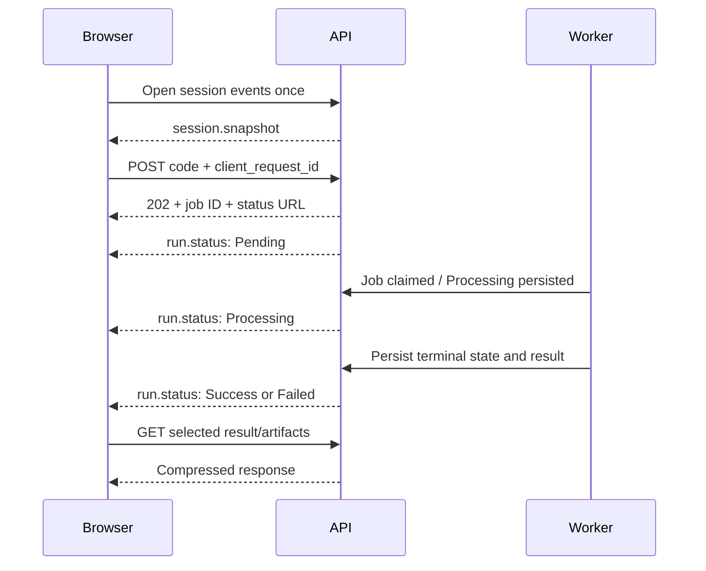

# Frontend/backend communication investigation

- **Status:** Draft for peer review; architecture and protocol proposals only.
- **Date:** 2026-11-14.
- **Repository baseline:** `b033e772db68a1d306a8748c69d1de76c90c5a6b`.

## 1. Summary and proposed direction

The largest opportunity is to reduce and selectively fetch execution data. Changing the notification transport is a useful architectural improvement, but accounts for much less of the potential bandwidth saving.

Proposed direction for review:

1. **Submit code over HTTP and give each accepted job a queryable status and result URL.** Notifications tell the browser when to refresh that state.
2. **Use one small, session-wide SSE stream per browser tab for job status, MCP activity, and agent execution requests**, provided the deployed browser-facing connection supports HTTP/2 and streams without buffering. A lightweight WebSocket carrying the same notifications is a credible lower-change option.
3. **Fetch results as compact UTF-8 JSON with HTTP compression.** Remove base64 from browser-facing results. Gzip is the straightforward baseline; Brotli deserves a production benchmark.
4. **Load the execution trace separately from output, AST, and bytecode.** Fetch frames when the animation needs them, with bounded chunks if necessary. Treat binary serialization and trace-schema changes as subsequent, measured decisions.

The default Fibonacci example produced **49.1 MiB of JSON, or 65.5 MiB of base64**, in the local investigation. The same JSON compressed to **662.3 KiB with gzip** or **222.6 KiB with Brotli**. Its execution section accounted for approximately **99.9%** of the JSON. These are payload measurements, not end-to-end latency measurements.

Three distinct decisions should receive review: notification delivery, the meaning of agent activity, and the representation/loading of large results.

## 2. Current implementation

### 2.1 Execution path

```text
Browser: run.submit over WebSocket
  -> session creates PostgreSQL job: Pending
  -> worker claims job: Processing
  -> Firecracker VM runs the interpreter with execution tracing
  -> interpreter collects frames, marshals one JSON document, base64-encodes it
  -> SSH CombinedOutput buffers the command output
  -> worker stores the result in PostgreSQL
  -> manager broadcasts run.result to every connected tab
  -> browser parses the envelope, calls atob(), then parses the result JSON
```

| Finding | Repository evidence | Consequence |
| --- | --- | --- |
| Browser submissions and complete results share `/ws/{session_id}`. | [agentSocket.ts](frontend/src/lib/agentSocket.ts), [session.go](backend/mcpserver/session.go): `handleRunSubmit`, `completeJob`, `writePump` | A large result occupies the same application write queue as activity/status messages. |
| WebSocket compression is not enabled in the upgrader. | [manager.go](backend/mcpserver/manager.go): `NewManager` | The application sends the base64 payload uncompressed. Actual production edge behavior was not inspected. |
| Structured output is compact JSON followed by base64 encoding. | [runtime/main.go](../runtime/main.go): structured-output block | The expansion starts inside the runtime, before PostgreSQL and the browser. Whitespace removal offers little additional saving. |
| The worker requests up to 10,000 trace frames and waits for buffered SSH output. | [microvm.go](backend/microvm/microvm.go): `RunCode`, `runSSHCommandWithTimeout` | No current browser transport receives frames while execution is in progress. |
| Frames contain repeated VM stack/call-frame, event-loop, and queue snapshots. | [trace.go](../runtime/trace/trace.go), [vm/trace.go](../runtime/vm/trace.go): `snapshotVM` | Thousands of frames can occupy tens of megabytes even with the existing limits. |
| `Processing` is persisted when a worker claims a job, but only acceptance and terminal results are pushed. | [db.go](backend/db/db.go): `GetOldestPendingJob`; [worker.go](backend/worker/worker.go) | A genuine pending/running distinction needs a worker-status notification, not just different browser event names. |
| Results are stored as a string in a PostgreSQL `text` column. | [db.go](backend/db/db.go), [initial migration](backend/db/migrations/000001_create_jobs_table.up.sql) | Successful results contain base64; failure results contain error text. There is no public single-job result endpoint. |
| Successful results are decoded with `JSON.parse(atob(message.result))`. | [+page.svelte](frontend/src/routes/+page.svelte): `handleRunResult` | The browser handles a large outer string, decoded string, and object graph. `atob()` also returns bytes represented as a string, rather than decoding UTF-8. |
| The animation expects a complete frame array and builds per-frame VM/output lookup arrays. | [ExecutionAnimation.svelte](frontend/src/routes/ExecutionAnimation.svelte): `frames`, `vmAtFrame`, `outputAtFrame` | Streaming bytes alone will not make playback memory-bounded. |
| History responses omit results, but the database query still selects and scans `result` for up to 100 jobs. The random-script query also loads it. | [db.go](backend/db/db.go): `jobColumns`, `GetJobsBySessionID`, `GetRandomJob`; [scripts.go](backend/mcpserver/scripts.go) | Large database-to-backend transfers occur even for small browser responses. The frontend refreshes history on acceptance and completion. |

The WebSocket sender marshals a broadcast once and queues references to those bytes for its connections; it does not necessarily allocate a complete independent envelope for every tab. Nevertheless, **every tab receives the full payload over the network**, even if it will ignore that run.

### 2.2 Existing session and MCP behavior

- A stable browser/device ID identifies the application session; multiple tabs share it. Each tab opens its own WebSocket. See [clientIdentity.ts](frontend/src/lib/clientIdentity.ts) and [agentSession.ts](frontend/src/lib/agentSession.ts).
- Only one active execution or pending MCP execute request is allowed per application session.
- An MCP `execute` call first broadcasts `execute.request` with source code. Tabs replace the editor contents and automatically submit it back; the first accepted submission creates the job. This browser round trip is part of the current behavior.
- The MCP caller receives **program output and job ID**, not the full AST/bytecode/trace. However, [mcp.go](backend/mcpserver/mcp.go): `decodeOutput` decodes the whole base64 document and scans its JSON to extract output.
- The MCP handler uses `StreamableHTTPOptions{Stateless: true, JSONResponse: true}`. Its activity indicator is based on HTTP requests, not a durable agent connection.
- Reconnecting browsers receive a snapshot of MCP/active-run state and, when idle, the last result if it is less than five minutes old. That five-minute check limits replay eligibility; it does **not** clear `lastResult` from memory at five minutes. A connected session can retain it until replacement or session closure.
- Session cleanup uses a 30-minute inactivity TTL when no browser is connected; MCP traffic also touches the session. Job-to-session bindings expire after ten minutes. These in-memory structures disappear on backend restart, while database job rows remain.
- Server-side last-result replay is not sufficient for fresh-page restoration: the frontend's `handleRunResult` filters results against local active/submitting state.

Relevant limits in [session.go](backend/mcpserver/session.go) are 1 MiB of source code, a 2 MiB inbound WebSocket message limit, 64 outgoing messages per connection, a 10-second write deadline, and a 120-second MCP wait. The interpreter command has a separate 10-second timeout. **The inbound message limit does not cap outbound results**, and a message-count queue limit does not bound its retained bytes.

## 3. Local payload measurements

### 3.1 Method

Built the runtime at the baseline commit with Go 1.26.3 on Linux/amd64 and ran six existing scripts, once each, using the backend's runtime flags:

```text
--structured --trace-execution --trace-max-frames=10000
```

The runs used the default JIT configuration, directly on the host rather than inside Firecracker. The four frontend examples all produced truncated traces under the existing capture policy. Stored frame counts can be below 10,000 because the recorder reserves capacity for interesting events and the final frame.

Measured the original base64 stdout, its decoded JSON bytes, and lossless compressed representations. Codec comparisons used Node 20.19.2, zlib 1.3.1, Brotli 1.1.0, `@msgpack/msgpack` 3.1.2, and `cbor-x` 1.6.0. CBOR used ordinary maps with `{useRecords: false, variableMapSize: true}`; no record-extension dictionary was introduced. Both binary formats encoded the same parsed JSON data without changing the application schema.

All six runs succeeded. Compression round trips and binary encode/decode deep equality were checked. Temporary executables, captures, and measurement dependencies were kept outside the repository under `/tmp/opencode/`.

### 3.2 Compression has the largest measured effect

Sizes below are **KiB (1,024 bytes)**, excluding HTTP/WebSocket headers and transport framing.

| Input | Stored frames | Current base64 | JSON | JSON + gzip level 6 | JSON + Brotli quality 5 |
| --- | ---: | ---: | ---: | ---: | ---: |
| [arithmetic](../test/test-scripts/arithmetic.js) | 67 | 80.7 | 60.5 | 5.7 | 4.6 |
| [async-fn-1](../test/test-scripts/async-fn-1.js) | 76 | 94.6 | 71.0 | 6.5 | 5.4 |
| [fibonacci](frontend/src/lib/examples/fibonacci.js) | 9,063 | 67,055.8 | 50,291.9 | 662.3 | 222.6 |
| [n-queens](frontend/src/lib/examples/n-queens.js) | 10,000 | 52,585.2 | 39,438.9 | 561.0 | 183.9 |
| [game-of-life](frontend/src/lib/examples/game-of-life.js) | 10,000 | 44,932.5 | 33,699.4 | 477.3 | 165.5 |
| [mandelbrot](frontend/src/lib/examples/mandelbrot.js) | 9,001 | 40,675.8 | 30,506.9 | 392.8 | 176.7 |

For the Fibonacci capture:

- JSON was **51,498,877 bytes**; base64 was **68,665,172 bytes**.
- Gzipped JSON was **678,150 bytes**, a **99.0% reduction** from the current base64 representation. Brotli JSON was **227,918 bytes**, a **99.7% reduction**.
- Gzipping base64 instead produced **2,248,419 bytes**. Compression and removing base64 are separate improvements; compressing the current envelope does not give the same result as compressing the underlying JSON.
- An overview containing output, AST, debug chunks, and trace metadata, with the frame array removed, was approximately **45.4 kB**, or **6.2 kB gzipped**. This is a reserialization estimate, excluding a future artifact manifest.
- At an illustrative **10 Mbit/s** payload throughput, transfer alone would take about **54.9 seconds** for base64 versus **0.54 seconds** for gzipped JSON. These calculations exclude RTT, congestion, execution, compression, parsing, and rendering. They explain why the current 10-second WebSocket write deadline can be problematic on slower connections.

The repetition in these traces compresses exceptionally well. Other programs, particularly those with varied large values or output, may compress much less well. PostgreSQL physical storage compression was not measured; these figures describe representations and transfer sizes.

### 3.3 A binary format is not automatically a better compressed payload

| Input | MessagePack size / JSON size, uncompressed | CBOR size / JSON size, uncompressed | JSON + gzip, KiB | MessagePack + gzip, KiB | CBOR + gzip, KiB |
| --- | ---: | ---: | ---: | ---: | ---: |
| arithmetic | 76.8% | 78.0% | 5.7 | 5.9 | 5.9 |
| async-fn-1 | 76.0% | 76.9% | 6.5 | 7.0 | 6.9 |
| fibonacci | 71.8% | 72.3% | 662.3 | 626.3 | 627.3 |
| n-queens | 76.4% | 76.9% | 561.0 | 560.0 | 560.6 |
| game-of-life | 78.7% | 78.8% | 477.3 | 516.7 | 516.4 |
| mandelbrot | 78.6% | 78.7% | 392.8 | 414.9 | 414.7 |

Plain binary serialization reduced uncompressed size by roughly 21–28%, but the advantage largely disappeared after compression. Some compressed binary payloads were larger. With Brotli, the Fibonacci sizes were 222.6 KiB for JSON, 215.7 KiB for MessagePack, and 216.1 KiB for CBOR: a much smaller distinction than enabling compression in the first place.

An exploratory timing check also illustrates the remaining CPU cost. On the local Intel i7-7700 host, the Fibonacci capture took approximately:

| Operation | Median milliseconds |
| --- | ---: |
| UTF-8 conversion + JSON parse | 363 |
| Base64 conversion/decode + UTF-8 conversion + JSON parse | 622 |
| MessagePack decode | 711 |
| CBOR decode | 643 |
| Gzip level 6 compression of JSON | 233 |
| Brotli quality 5 compression of JSON | 124 |

These are one warm-up plus three timed operations per case, with explicit GC before each timed operation. Decode timings exclude decompression, network, and rendering; the base64 timing excludes parsing the outer WebSocket envelope. They are **Node-library measurements**, not browser benchmarks or predictions for Go codec implementations. They support benchmarking the complete path rather than assuming binary decoding or a particular compression level is faster.

## 4. How should execution completion reach the frontend?

### 4.1 Transport comparison

SSE is a specific form of streaming HTTP: UTF-8 events framed as `text/event-stream`. Native `EventSource` provides event dispatch and reconnection. A `fetch()` response stream can carry SSE, newline-delimited JSON (NDJSON), or binary records, but application code must supply the corresponding parsing and recovery behavior. MCP's **Streamable HTTP** is a separate protocol binding; its name does not imply that the browser should consume the MCP endpoint.

| Option | Strengths here | Costs / limitations | Assessment |
| --- | --- | --- | --- |
| HTTP commands/results + small WebSocket notifications | Reuses existing connection management; supports future interactive debugging; avoids large result broadcasts | Application still owns reconnect, resynchronization, and event protocol | Strong lower-change option; captures most payload benefits |
| HTTP commands/results + one session SSE stream | Fits predominantly server-to-browser notifications; standard HTTP infrastructure; native event IDs/reconnect | Still holds a stream open; HTTP/1.1 connection limits; proxy flushing required; native `EventSource` cannot set arbitrary headers | Preferred candidate if deployment supports it |
| HTTP commands/results + `fetch()` streaming | Custom headers, explicit cancellation, stream-reader control, text or binary framing | Must implement parsing, reconnect, cursor handling, and duplicate handling | Useful for artifact streaming or header-based client requirements |
| HTTP commands/results + polling or long polling | Simple HTTP-only fallback; durable status APIs provide the foundation | Polling delays updates and generates repeated requests; long polling still occupies requests and needs reconnect handling | Good fallback; reasonable primary choice at very small scale |
| Keep a submission request open until completion | Simple for short, predictable jobs; can return the result directly | Queue/VM delays and intermediaries can time out; recovery still needs job IDs; MCP activity still needs a separate notification path | Weaker fit for this application |

Ordinary WebSockets have low framing overhead and can carry raw JSON or binary directly. Base64 is an application choice, not a WebSocket requirement. SSE may have more framing bytes for small messages; replacing an idle WebSocket with an idle SSE stream does not eliminate connection resources or keep-alives.

The benefits of the proposed split are **selective downloads, independent retries, HTTP compression/caching, and status messages no longer waiting behind a giant result in the application queue**. HTTP result retrieval also adds a round trip after completion, which may matter more for tiny results than for large traces. HTTP/2 streams still share network capacity, and HTTP/2 over TCP still shares connection-level packet-loss effects.

Avoid a new listener for every execution. MCP activity can happen while no job is running, so a session listener is useful throughout the page's lifetime. Multiplex all small notifications onto that listener.

Manual submission should depend on the HTTP API being available, with status polling as a fallback if the event stream is temporarily unavailable. It should not depend on an active MCP agent. If polling is chosen as the primary transport, polling every `P` seconds for `N` tabs produces approximately `N / P` requests per second and `P / 2` average detection delay for uniformly timed changes, before network/processing time. MCP activity requires those polls even while no execution is running.

### 4.2 Candidate HTTP and event contract

The following routes are illustrative review proposals. They use the existing `/session` prefix, which is already proxied by [vite.config.ts](frontend/vite.config.ts).

| Operation | Purpose |
| --- | --- |
| `POST /session/{s}/jobs` | Submit source and a stable `client_request_id`; return a job ID and status URL |
| `GET /session/{s}/jobs/{j}` | Small, authoritative job status, revision, error information, and available artifact URLs |
| `GET /session/{s}/jobs/{j}/result` | Baseline: successful `format_version: 2` result as compressed JSON, without a base64 envelope |
| `GET /session/{s}/events` | Long-lived browser SSE stream for session, execution, and MCP notifications |
| `GET /session/{s}/state` | Recoverable session snapshot for initial load, reconnect, and polling fallback |
| `GET /session/{s}/execute-requests/{r}` | MCP request source/lifecycle metadata, resolving accepted requests to their jobs; notifications can carry a URL instead of up to 1 MiB of code |
| `POST /session/{s}/execute-requests/{r}/reject` | Preserve the existing editor-not-ready/busy rejection path over HTTP |

Every job read must match both the job ID and its application session. Status/history queries should select metadata only, rather than fetching the large result column.

Example submission:

```http
POST /session/{s}/jobs
Content-Type: application/json

{"client_request_id":"client-generated-uuid","code":"console.log(2)"}
```

```http
HTTP/1.1 202 Accepted
Location: /session/{s}/jobs/{j}
Content-Type: application/json
Cache-Control: no-store

{"job_id":"{j}","request_id":"{r}","client_request_id":"client-generated-uuid","job_status":"Pending","version":1,"status_url":"/session/{s}/jobs/{j}"}
```

Example event, sent only after the successful result is retrievable:

```text
id: session-epoch:42
event: run.status
data: {"schema_version":1,"job_id":"{j}","request_id":"{r}","client_request_id":"client-generated-uuid","version":3,"job_status":"Success","result_url":"/session/{s}/jobs/{j}/result"}

```

The event ID is a notification cursor. `version` is a monotonically increasing job-state revision. Both are distinct from the trace's `frame.seq` and its `execution.schema_version`.



State mapping can preserve the existing names:

```text
Pending -> Processing -> Success
   |            |
   +----------> Failed
```

- `Pending` means durably accepted into the queue; `Processing` means a worker has claimed the job, including VM startup. Neither is instruction-level progress.
- `Success` means the required result is published and fetchable. Persisting or publishing an artifact must finish before advertising its URL as ready.
- `Failed` includes queue/worker/runtime/result-publication failures, with a message and a phase/code when known. The current failure text needs normalization rather than unconditional base64 decoding.
- A known failed job is a successful status lookup: `GET .../jobs/{j}` returns `200` with `job_status: "Failed"`. HTTP failures describe the API request itself.
- For the baseline result route, a proposed contract is `200` for ready JSON, `202` plus `Retry-After` and status metadata while pending/processing, and `409` with a structured `execution_failed` response for a failed job. Clients must check the exact status before parsing a success payload.
- Use `400`/`413` for invalid/oversized submissions, `409` for session conflicts, and `503` for unavailable capacity before acceptance. Unknown or differently scoped jobs return `404`; an explicitly expired result can return `410` if expiry metadata is retained.
- Aborting a browser fetch or losing its event connection does not cancel an accepted job. A client wait timeout should retain the job ID and permit status recovery. Server job deadlines and any explicit cancellation policy are separate concerns.

### 4.3 Races, retries, and recovery are part of the design

1. **Completion before listening:** Open the session listener on page initialization, but do not rely on that ordering alone. Every accepted submission has a queryable status URL; a subscription begins with current state. A job that finishes before the stream connects remains discoverable.
2. **Completion before the POST reply:** An event can arrive before the `202` response. Register the `client_request_id` locally before submitting, include it in events, and avoid overwriting a newer job revision with an older response.
3. **Lost POST response:** Retry with the same `client_request_id`. Enforce an atomic session-scoped uniqueness rule and retain the source/options fingerprint. The same key and payload returns the existing job; a different payload using that key is a conflict. The current backend-generated manual `request_id` is not sufficient for this retry contract.
4. **Reconnect or reload:** Send a `session.snapshot` with MCP activity, pending execute request, active job, and latest terminal-job metadata. Re-query any locally tracked job IDs. Snapshots contain result references rather than result bodies.
5. **Snapshot/subscription race:** Register the subscriber and establish an ordering boundary before delivering the snapshot. Queue concurrent changes during snapshot construction, then deliver newer revisions. Snapshot generation and event publication must not leave a gap.
6. **Replay:** Native SSE reconnection and `Last-Event-ID` do not create a server event log. A minimal first version can explicitly guarantee snapshot/status reconciliation on every reconnect. If short event replay is added, bound it by bytes and age; an expired cursor or changed server/session epoch produces a reset snapshot. Browser reloads also need a snapshot, since a new `EventSource` does not automatically inherit the previous object's cursor.
7. **Duplicates and stale events:** Make status application and result fetching idempotent by job ID/revision. Replayed MCP execution requests must not execute twice. An explicit `execute_request_id` must identify a still-valid pending request; a delayed request after expiry must not become a new manual execution.
8. **Slow clients:** Bound event queues by both count and bytes. If a client falls behind, close its stream and recover from state instead of silently losing terminal transitions or retaining unbounded data. Result downloads must not block the worker or event broadcaster.
9. **Backend restart:** Database rows alone do not currently restore in-memory job bindings or wake the channel-driven worker queue. Terminal jobs can be recovered from storage, but pending/stale `Processing` jobs need reconciliation and an explicit interrupted/timeout policy. HTTP/SSE does not itself provide restart-safe execution or exactly-once execution.

A missed notification should affect how quickly the UI updates, not whether a result can ever be recovered. Notifications are hints about durable job state. Pending browser-relay MCP requests and agent activity remain transient unless the review explicitly chooses to persist them.

### 4.4 Deployment requirements for SSE

- Send `Content-Type: text/event-stream`, prevent event-stream caching, terminate each event with a blank line, and flush promptly. The current logging response wrapper already exposes flushing.
- Disable intermediary response buffering for this route; `X-Accel-Buffering: no` is relevant to nginx, but the actual ingress configuration must also be checked.
- Send a comment heartbeat approximately every 15–30 seconds, below the deployed idle timeout. Keep-alives preserve the browser notification stream; they do not indicate agent activity.
- Avoid compression buffering on tiny event messages. Leave this stream uncompressed initially, or explicitly test flushing through the compression layer.
- Check disconnect cancellation and per-write deadlines for a long-lived handler. A normal whole-response timeout must not terminate every healthy stream.
- Prefer HTTP/2 on the **browser-facing** hop. Native SSE over HTTP/1.1 commonly shares a roughly six-connection per-origin browser limit across tabs, which can also block ordinary fetches. The repository currently shows plain `http.ListenAndServe` and no production TLS/HTTP/2 ingress configuration; HTTP/2 must be verified, not assumed.
- Native `EventSource` uses GET and exposes a credentials option, but no arbitrary-header option. Same-origin operation fits the current frontend. If custom authorization headers become necessary, a fetch-based SSE client is an option. Cross-origin cookie use would require a corresponding CORS configuration rather than the current wildcard policy.
- Initially keep one listener per tab. Sharing one listener using a `SharedWorker`/tab coordination can reduce connections later, but introduces ownership and failure-recovery complexity.
- Update application-session creation, frontend availability, and TTL accounting to recognize SSE subscribers. The current `Session.Run`, `isConnected`, and cleanup behavior depend on the WebSocket connection registry; adding an SSE route alone would not satisfy the existing MCP requirement for a connected frontend.

If the deployed connection is HTTP/1.1 and many simultaneous tabs are important, retaining a lightweight WebSocket may be preferable. Either transport still benefits from the same status API and compressed result retrieval.

With multiple backend replicas, separate POST/GET/event requests also need a shared view of the session: session affinity can be a transitional solution, while shared state/event fan-out enables independent routing. SSE itself does not synchronize the current in-memory manager. Any cross-instance notification should carry job IDs/metadata rather than trace bodies.

## 5. How should MCP agent activity reach the frontend?

### 5.1 Define what the indicator actually means

The current application can reliably observe **MCP requests and in-flight work**, rather than prove that an agent is continuously connected or has permanently disconnected.

[manager.go](backend/mcpserver/manager.go): `HandleMCP` currently counts POST bodies containing a JSON-RPC-like `method` field before the SDK validates the request. [session.go](backend/mcpserver/session.go): `beginMCPRequest` records request-start time and increments an in-flight counter. When all counted requests finish, a 60-second timer eventually changes `active` to `idle`. A long-running tool call remains active beyond 60 seconds.

Proposed semantics:

| State | Meaning |
| --- | --- |
| `waiting` | No qualifying MCP activity observed in this session's known lifetime |
| `active` | A qualifying request is in flight, or the latest completed request is within the activity window |
| `idle` | Activity was observed previously, but no request is in flight and the activity window has elapsed |
| Frontend freshness: unknown/stale | The browser notification connection is unavailable, so its cached agent state may be outdated |

Use UI wording such as **“Agent active”** and **“Last active …”**, with a separate browser/server connection indicator. An idle agent may still be running elsewhere and keeping the endpoint configured.

Count protocol-valid, admitted MCP activity; a tool execution that returns a program error still represents genuine use. Malformed/rejected protocol traffic should not imply an active agent. Keep `last_seen_at` as the latest admitted request's arrival time, while starting the idle countdown when the final in-flight request finishes. Include `in_flight`/active job information if the UI needs to distinguish discovery traffic from an executing tool. The existing wrapper's preliminary method check is weaker than this proposed definition.

### 5.2 Delivery

Publish a small event on the same browser session stream:

```text
id: session-epoch:43
event: mcp.status
data: {"schema_version":1,"state":"active","last_seen_at":"2026-11-14T12:00:00Z","in_flight":1,"active_job_id":"{j}"}

```

- Emit state transitions promptly; coalesce frequent last-seen updates instead of broadcasting a timestamp for every request.
- Include current activity in every session snapshot, so a tab opened after the agent's request gets the right state.
- Keep the server authoritative for expiry while a request is in flight. On browser disconnect, mark the display stale rather than declaring the agent idle.
- With multiple agents using the same endpoint, this is aggregate session activity. Per-agent counts or identities require an additional identity/lifetime contract.

If **“agent connected/disconnected”** is a strict product requirement, define an agent registration/lease plus heartbeat and expiry semantics, or an appropriate supported protocol subscription lifetime. A one-shot HTTP request, TCP keep-alive, or initialization exchange alone cannot provide that guarantee. This adds agent-client coordination; changing the browser to SSE does not supply it.

The browser event endpoint should be an application endpoint. The configured stateless Go MCP handler does not offer a standalone GET event stream. Also, the MCP 2026-07-28 transport revision removed standalone GET streams and protocol-level sessions; older revisions have different rules. Application SSE cursors/replay described here are independent of MCP transport rules. See [MCP Streamable HTTP][mcp-http] and the [Go SDK transport options][mcp-sdk].

### 5.3 Preserve the agent execution workflow explicitly

For a transport-only migration, preserve the current automatic workflow:

```text
MCP execute
  -> browser execute.request notification (request ID + source URL)
  -> tabs fetch source, update editor, and POST the submission
  -> one accepted job
  -> browser status notification + HTTP result fetch
  -> MCP returns program output + job ID
```

Use the server-issued execute-request ID to deduplicate submissions from multiple tabs. Keep the existing not-ready/busy rejection behavior available through HTTP, and ensure a late rejection cannot fail an already accepted job. This is automatic coordination, not a new user approval step.

Retain the source descriptor through acceptance, or resolve it to the accepted job's source, so slower tabs can still load the code after another tab wins submission. Advertise an expiry and reject execution attempts against expired request IDs.

An alternative is to queue MCP executions directly in the backend and notify tabs to update their editors. That removes the browser round trip and can support execution with no tab open, but changes current behavior and the MCP tool's documented requirement. Peer review should choose that explicitly rather than make it an accidental consequence of transport work. The current accepted job also survives loss of the waiting MCP request; cancellation behavior must account for the negotiated MCP revision and the worker lifecycle, independently of the browser notification transport.

The MCP response can continue returning only output and job ID. Store/expose output separately during result normalization so extracting it does not require decoding a tens-of-megabytes trace on each tool completion.

## 6. Efficient transfer and loading of large results

### 6.1 First baseline: direct JSON with HTTP content encoding

Base64 encodes `n` bytes as `4 * ceil(n / 3)` bytes: approximately 33% expansion. Removing it saves approximately 25% of the currently encoded length before compression, as well as an encode/decode step.

Serve the JSON bytes directly:

```http
Content-Type: application/json
Content-Encoding: gzip
Vary: Accept-Encoding
```

The browser negotiates `Accept-Encoding` and transparently decompresses the response. `fetch(...).json()` then performs one JSON parse without `atob()`. This also provides the proper UTF-8 decoding path for Unicode output such as the example scripts' chess and block characters.

Important details:

- HTTP does not automatically compress responses just because they are JSON. Add compression at a deliberately chosen backend or edge layer; the current Go handler chain does not contain it.
- Return a JSON document, rather than a JSON string containing another document. In Go, merely changing a field to `[]byte` still produces base64 when marshaled by `encoding/json`; raw JSON needs an appropriate response/representation.
- Negotiate supported encodings, including clients that do not accept a particular coding. Gzip has a standard-library Go implementation. Brotli quality 5 is a strong candidate from these measurements, but needs Go/edge CPU and real-browser measurements. Zstandard can also be evaluated where negotiated; retain a supported fallback.
- Compress immutable artifacts once and reuse the encoded bytes where practical. Repeatedly decoding, reserializing, and compressing a 50 MiB result for every tab/reconnect can replace a bandwidth bottleneck with a CPU bottleneck.
- Live status and activity responses should not be cached. Completed artifacts can use private caching and ETags, with a freshness lifetime consistent with the agreed retention policy. Use encoding-specific strong ETags or an appropriate weak validator, and preserve `Vary: Accept-Encoding`, including on `304` responses. Add `Vary: Accept` if representation format is negotiated too.
- Give result retention its own policy and expose expiry where useful. The current five-minute replay gate, 30-minute session TTL, and persistent database history are different concepts.

Code submission is already a plain string inside JSON from the browser; it is not currently base64-encoded on that hop. Its typical size is much smaller than a trace, so there is little reason to introduce a binary request format first. The separate base64 encoding used to inject source into the VM's shell command serves a different purpose.

### 6.2 Separate the overview from the trace

The current default result view shows output, AST, and bytecode; animation is a separate view. This makes deferred trace loading particularly valuable.

Proposed artifact organization after the baseline:

| Artifact | Contents | Loading policy |
| --- | --- | --- |
| Manifest / status | Job status, format versions, counts, byte sizes, artifact URLs, expiry, trace completeness | Small, eager |
| Overview | Output, AST, debug chunks, execution metadata without frame bodies | Fetch when the result is selected |
| Trace chunks | Bounded groups of stored frames plus chunk-start playback state | Fetch on animation use; prefetch a small window |
| Optional individual AST/bytecode/output artifacts | Useful if one overview section also becomes large | Add when measurements justify finer separation |

Introduce an explicitly versioned split-result contract or new artifact routes. Do not silently return an incomplete `InterpretDetails` object where existing clients expect `execution.frames` to be present.

Chunking considerations:

- Target a bounded uncompressed byte size as well as a frame-count cap. A tentative experiment is 0.5–2 MiB per chunk with at most 100–500 frames; actual limits should follow browser memory/seek measurements.
- Address chunks by an opaque cursor or stored-frame index. `frame.seq` can have gaps after capture truncation, so sequence numbers are not array offsets.
- Preserve `total_frames`, stored count, `dropped_frames`, `truncated`, final output, and schema versions. A chunk download failure is not the same as a runtime-truncated trace.
- Full snapshots simplify seeking, but some frames omit `vm` and output is delta-encoded. An independently loadable chunk needs the carry-forward VM state and an output checkpoint/reference at its start. Existing output lengths originate as Go byte lengths; any offset contract must specify UTF-8 bytes versus JavaScript string indices.
- Maintain a bounded decoded-frame window, and release old runs/chunks when the UI no longer needs them. Downloading chunks and concatenating them into the same giant array does not solve peak memory use.
- Avoid one HTTP request per frame. In an exploratory split of the Fibonacci capture, independently gzipping frame arrays in groups of 500 produced about 666.6 KiB in total, versus 662.3 KiB for the entire original result. This estimate excludes overview, manifests, and playback checkpoints, but shows that batching can retain much of the compression benefit.
- Ordinary byte-range requests into one gzip-compressed JSON file do not provide random access to JSON frames. Separate independently compressed chunks or an indexed format are needed for useful seeking/resume.

Notifications should go to all relevant tabs; large artifacts should be fetched only by tabs actually displaying that job/view. Deduplicate concurrent requests for the same immutable artifact within a client. This is where separating notifications from results reduces unnecessary fan-out.

### 6.3 Streaming HTTP, NDJSON, and true live frames

For a completed trace, a `fetch()` body stream carrying NDJSON can make the first batches available before the whole download finishes. Each record is a JSON object followed by a newline; embedded newlines in values remain escaped JSON. The client must handle network chunks splitting records and UTF-8 characters, batch updates, and distinguish a valid end marker from a truncated connection.

Calling `response.json()` still reads and parses the complete document. A stream reader enables incremental consumption, but memory stays bounded only if the application also bounds retained data. `EventSource` is well suited to tiny notifications; it offers no application-controlled pull interface and cannot carry raw binary payloads.

**Live frames during execution require a broader pipeline change.** Today the recorder retains frames, `main.go` marshals after execution, and SSH uses `CombinedOutput`. Live delivery would require incremental runtime serialization, separate result/log channels, bounded producer/consumer buffers, worker forwarding/persistence, and defined partial-trace/error semantics. Adding SSE or HTTP chunked transfer at the final browser hop cannot bypass those buffers.

For this application, independently fetchable completed chunks are the simpler initial route to responsive playback and retryable downloads. Live execution streaming should be chosen based on a product requirement for seeing progress before execution ends.

### 6.4 Serialization options

| Representation | Potential benefit | Cost / fit for this repository |
| --- | --- | --- |
| **JSON + gzip/Brotli** | Large measured bandwidth reduction; native browser decoding; readable captures; flexible AST | Still materializes a large object graph unless artifacts/chunks are selective; preferred baseline |
| **MessagePack** | Schema-less mapping close to JSON; compact numeric/string encodings; Go and JS libraries | Ordinary maps repeat keys; extra decoder dependency; no consistent compressed-size win in the sample corpus |
| **CBOR** | Standardized binary format, `application/cbor`, extensible types and streaming sequences | Similar measured trade-off to MessagePack; define a compatible subset and avoid uncoordinated library-specific extensions |
| **Protocol Buffers** | Numeric field tags, typed contracts, generated Go/TS code; good candidate for stable trace-frame structures | Requires schema/code generation and explicit field evolution; the heterogeneous AST is less natural; wrapping the existing JSON in a `bytes` field adds little value |
| **FlatBuffers** | Access selected fields through buffer-backed views without eagerly materializing every nested object | Larger integration/schema change; benefit depends on using lazy accessors rather than immediately rebuilding the current JS object graph; not necessarily smallest on the wire |

Binary formats can be sent as raw HTTP response bytes and read with `arrayBuffer()` or an appropriate streaming decoder. WebSockets can also send binary frames. Putting binary or compressed bytes back inside base64 JSON/SSE adds the encoding overhead again.

A schema-level optimization is another option: intern repeated function/opcode/value descriptions, share immutable snapshot components, or use deltas plus periodic checkpoints. This can reduce decompressed data and object allocation in ways ordinary compression cannot. However:

- The current full-snapshot design intentionally supports seeking; see the [Execution Animation Plan](../runtime/EXECUTION%20ANIMATION%20PLAN.md).
- Deltas require replay from a checkpoint, clear deletion/reset semantics, and state at each chunk boundary. A reference to a mutable VM object ID is not automatically a reference to an immutable historical value.
- Version changes must preserve optional/absent fields, Unicode, numeric precision, trace gaps, and stable AST/chunk references. Binary support for 64-bit integers does not make JavaScript `Number` exact above its safe range.
- Converting a compact representation straight back into every original frame object can give away the memory benefit.

Benchmark any binary/schema candidate against **compressed JSON with the same loading policy**, not against today's uncompressed base64. Select based on time-to-usable-result, decode/GC cost, peak browser heap, and operational complexity as well as wire bytes. These measurements do not currently justify making binary serialization a prerequisite.

### 6.5 Backend storage and frontend processing also matter

Moving the result to HTTP initially can decode legacy base64 records on read, enabling a staged migration. That first step does not remove upstream runtime/base64 allocation or database traffic.

The more complete path is to normalize each result once after execution, extract small metadata/output, and persist immutable artifacts. PostgreSQL binary artifact storage or a blob/object store are options; the measurements alone do not require a new storage service. Separate lightweight status/history queries from blob retrieval, including the existing random-script path. Record the stored representation explicitly so old base64 results remain readable during migration.

Sessions, reconnect snapshots, and result-notification channels should retain metadata/references rather than whole trace strings. Publishing a success event before storage commits creates a result-fetch race; a storage failure must have a recoverable status path. The current worker can report an in-memory failure after a database update fails, so restart/reconciliation behavior needs consideration too.

On the frontend, compression does not eliminate parse/render costs. If chunked JSON still causes long tasks, evaluate fetching/parsing in a Web Worker and serving the UI only the needed frame window. Posting an entire decoded graph back to the main thread can introduce structured-clone work and extra memory. Binary buffers can be transferred, but the UI's access pattern remains the deciding factor.

## 7. Suggested sequence if approved

| Stage | Deliverable | What to measure before proceeding |
| --- | --- | --- |
| 1. Establish the result/status contract | Idempotent HTTP submission, metadata-only status/history reads, fetchable compressed JSON results, metadata-only completion notifications; legacy stored-result support | End-to-end improvement, DB bytes read, compression CPU, retry/recovery correctness |
| 2. Choose and validate notification delivery | Session SSE if deployment permits, or retain lightweight WS; snapshot/reconnect rules; MCP activity and browser-relay behavior | HTTP/2/proxy behavior, multiple tabs, lost events, presence latency during large downloads |
| 3. Make trace loading selective | Overview/manifest plus independently loadable trace chunks, bounded frontend retention; evaluate Brotli | First usable output/AST, animation start and seek latency, compressed bytes, peak heap/long tasks |
| 4. Consider additional format/runtime work | Binary/schema compaction or genuinely live runtime streaming only when the remaining bottleneck requires it | Same-corpus, same-loading-policy comparisons with actual Go encoders and supported browsers |

These stages can be adjusted after review. In particular, the measured default trace size makes selective loading an early priority even if gzip removes the immediate network bottleneck.

During a staged rollout, legacy and new transport adapters need the same job coordination and deduplication rules. Select one notification protocol per tab through an explicit client/API version or capability, so attaching both connections does not trigger duplicate automatic MCP submissions. Version stored artifacts separately from the notification protocol to allow independent rollout and rollback.

### Validation plan for a future implementation

- **Job lifecycle:** queued, processing, success, runtime failure, queue rejection, VM timeout, and result-persistence failure. Retain recoverable job identity after client timeout; verify manual runs with no active MCP agent and polling recovery when the event stream is unavailable.
- **Races:** completion before subscription, completion before POST response, dropped acceptance reply, duplicate POSTs, same idempotency key with different source, duplicate/reordered events.
- **Recovery:** disconnect during execution and result download, fresh-page reload, expired replay cursor, backend/session epoch change, persisted terminal-job retrieval, and stale processing-job reconciliation.
- **MCP:** activity before any browser attaches, idle expiry, a tool call lasting beyond the idle window, malformed protocol traffic, multiple tabs submitting the same execute request, expired requests, and rejection arriving after acceptance.
- **Large data:** all four shipped examples, deep stacks, varied/high-entropy values, large output, Unicode, maximum source size, and interrupted/chunked traces. Check random seeking across VM/output checkpoint boundaries and frame-sequence gaps.
- **Deployment:** actual browser-facing HTTP version, proxy buffering, idle timeouts, multiple tabs under HTTP/1.1 and HTTP/2, slow consumers, and notification responsiveness during artifact downloads.
- **Representations:** gzip/Brotli negotiation and round trips, content types, cache validators/`Vary`, old stored results, supported schema versions, and equivalence of program output/AST/bytecode/trace semantics.
- **Performance:** measure submit-to-accept, queue/VM/execution time, result publication time, first usable overview, animation-ready time, notification latency, payload bytes, backend CPU/allocations, database transfer, browser heap, and main-thread long tasks. Record p50/p95 across real browsers and representative network/CPU profiles.

Proposed review targets include no frame-body transfer before the animation is requested, no full result-column reads for metadata endpoints, bounded event/decoded-frame buffers, and reliable recovery without rerunning a completed job. Numeric latency/heap budgets should be set for the supported devices and deployment rather than inferred from the local codec test.

## 8. Decisions requested from reviewers

1. **Notification transport:** adopt session SSE after HTTP/2/proxy validation, or retain small WebSocket notifications? The bulk-data improvements apply to both.
2. **Agent semantics:** is recent/in-flight MCP activity the desired signal, or is explicit per-agent presence with leases required?
3. **Execution coordination:** preserve the automatic browser relay for MCP, or deliberately move MCP job creation directly into the backend? What should request cancellation mean for accepted jobs?
4. **Artifact contract:** introduce lazy trace loading immediately or after the compressed full-result baseline? Agree on chunk/checkpoint behavior, result retention, idempotency retention, and restart recovery expectations.
5. **Compression/format:** use JSON + gzip as the baseline and benchmark Brotli next? Require a demonstrated complete-path benefit before accepting a binary/schema migration?

Open evidence gaps are the production ingress configuration, real job/payload distributions, how often users open animation, concurrent tab/session counts, low-end browser memory/parse behavior, and the desired result lifetime. They affect the final choices; the local measurements establish that large, repetitive snapshots and unnecessary loading are already worth addressing.

## Appendix A. Reproducing the size comparison

Run from `runtime/`, using the baseline commit and source files linked in section 3. This example captures Fibonacci; substitute each other input to reproduce the corpus. Captures vary slightly because timing/output and asynchronous scheduling are not fixed.

```sh
go build -o /tmp/opencode/go-js-communication-runtime .
/tmp/opencode/go-js-communication-runtime --structured --trace-execution --trace-max-frames=10000 ../web/frontend/src/lib/examples/fibonacci.js > /tmp/opencode/fibonacci.b64
npm install --prefix /tmp/opencode/go-js-codec-review --ignore-scripts --no-audit --no-fund @msgpack/msgpack@3.1.2 cbor-x@1.6.0
```

The following Node script computes the principal size comparison and verifies codec round trips. Save/run it in `/tmp/opencode/go-js-codec-review/` so its temporary dependencies resolve.

```js
const fs = require("node:fs");
const assert = require("node:assert/strict");
const z = require("node:zlib");
const mp = require("@msgpack/msgpack");
const { Encoder } = require("cbor-x");
const cbor = new Encoder({ useRecords: false, variableMapSize: true });
const base64 = fs.readFileSync("/tmp/opencode/fibonacci.b64");
const json = Buffer.from(base64.toString("ascii").trim(), "base64");
const data = JSON.parse(json.toString("utf8"));
const packed = mp.encode(data);
const encodedCBOR = cbor.encode(data);
assert.deepStrictEqual(mp.decode(packed), data);
assert.deepStrictEqual(cbor.decode(encodedCBOR), data);
for (const [name, bytes] of Object.entries({ base64, json, packed, encodedCBOR })) {
  const gzip = z.gzipSync(bytes, { level: 6 });
  const br = z.brotliCompressSync(bytes, {
    params: { [z.constants.BROTLI_PARAM_QUALITY]: 5 },
  });
  assert.deepStrictEqual(z.gunzipSync(gzip), Buffer.from(bytes));
  assert.deepStrictEqual(z.brotliDecompressSync(br), Buffer.from(bytes));
  console.log(name, { bytes: bytes.length, gzip: gzip.length, brotli: br.length });
}
console.log("stored frames", data.execution.frames.length);
```

## Appendix B. External references

Consulted on 2026-11-14. Repository source links above establish current application behavior; these references establish transport and format capabilities.

- [MDN: Using server-sent events][sse] — framing, named events, keep-alives, reconnect, and HTTP/1.1 connection limits.
- [MDN: EventSource constructor][eventsource] — GET-oriented native API and credentials option.
- [MDN: Using Fetch][fetch] — response streams, incremental consumption, and cancellation.
- [MDN: WebSocket][websocket] — browser API and lack of receive-side application backpressure.
- [Gorilla WebSocket v1.5.3 documentation][gorilla] — text/binary messages and opt-in per-message compression.
- [MDN: Content-Encoding][content-encoding], [Accept-Encoding][accept-encoding], and [Vary][vary] — HTTP compression negotiation and cache variants.
- [MCP Streamable HTTP, revision 2026-07-28][mcp-http], [revision 2025-11-25][mcp-older], and [Go SDK v1.8.0 options][mcp-sdk] — distinguish application browser events from MCP's versioned transport behavior.
- [MessagePack specification][msgpack], [CBOR RFC 8949][cbor], [Protocol Buffers wire encoding][protobuf], and [FlatBuffers overview][flatbuffers] — binary representation trade-offs.

[sse]: https://developer.mozilla.org/en-US/docs/Web/API/Server-sent_events/Using_server-sent_events
[eventsource]: https://developer.mozilla.org/en-US/docs/Web/API/EventSource/EventSource
[fetch]: https://developer.mozilla.org/en-US/docs/Web/API/Fetch_API/Using_Fetch
[websocket]: https://developer.mozilla.org/en-US/docs/Web/API/WebSocket
[gorilla]: https://github.com/gorilla/websocket/blob/v1.5.3/doc.go
[content-encoding]: https://developer.mozilla.org/en-US/docs/Web/HTTP/Reference/Headers/Content-Encoding
[accept-encoding]: https://developer.mozilla.org/en-US/docs/Web/HTTP/Reference/Headers/Accept-Encoding
[vary]: https://developer.mozilla.org/en-US/docs/Web/HTTP/Reference/Headers/Vary
[mcp-http]: https://modelcontextprotocol.io/specification/2026-07-28/basic/transports/streamable-http
[mcp-older]: https://modelcontextprotocol.io/specification/2025-11-25/basic/transports
[mcp-sdk]: https://github.com/modelcontextprotocol/go-sdk/blob/v1.8.0/mcp/streamable.go
[msgpack]: https://github.com/msgpack/msgpack/blob/master/spec.md
[cbor]: https://www.rfc-editor.org/rfc/rfc8949.html
[protobuf]: https://protobuf.dev/programming-guides/encoding/
[flatbuffers]: https://flatbuffers.dev/
